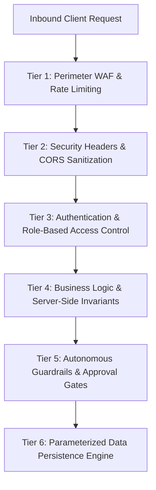

# AutoHeal v3.0 — Enterprise Security Architecture & Assurance
**Platform:** AutoHeal AI-Assisted Autonomous Security Operations Center (SOC)  
**Target Application:** ShopSphere E-Commerce Application  
**Version:** `3.0.0-enterprise`  
**Security Lead:** Principal Application Security Engineer  
**Date:** November 1, 2026  

---

## 1. Defense-in-Depth Security Strategy

AutoHeal v3.0 is constructed on a 6-tier defense-in-depth model that protects both the cybersecurity control plane and the monitored e-commerce storefront:

---

## 2. Security Tiers & Protective Mechanisms

### Tier 1: Perimeter WAF & Sliding-Window Rate Limiting
Implemented in `AppSecProtectionMiddleware` (`src/appsec/middleware.py`):
- **Deterministic Regex Filtering:** Pre-router inspection intercepts SQLi, XSS, and Path Traversal payloads, returning `HTTP 403 Forbidden` with header `X-Correlation-ID`.
- **Sliding-Window Rate Limiter:** Enforces a sliding ring buffer (15 requests in 8.0s). Bursts exceeding the threshold return `HTTP 429 Too Many Requests` and ban the client IP in `blocked_clients`.

### Tier 2: Security Headers & Network Sanitization
Every HTTP response emitted by the ASGI server carries enterprise security headers:
- `X-Content-Type-Options: nosniff` — Prevents MIME-type sniffing.
- `X-Frame-Options: DENY` — Prohibits clickjacking by preventing iframe embedding.
- `X-XSS-Protection: 1; mode=block` — Enables legacy browser XSS filters.
- `Referrer-Policy: strict-origin-when-cross-origin` — Protects referral leakage.

### Tier 3: Identity & Role-Based Access Control (RBAC)
- **Password Hashing:** Passwords hashed with salted cryptographic algorithms (bcrypt/SHA-256 + salt); raw passwords are never logged or stored.
- **JWT Bearer Authentication:** Cryptographically signed tokens with expiration timestamps (`exp`).
- **Strict Role Boundaries:**
  - `ROLE_CUSTOMER`: Restricted to catalog and personal cart/orders.
  - `ROLE_ANALYST`: Permitted to investigate incidents, query events, and run dry-runs.
  - `ROLE_ADMIN`: Full access to user management, high-impact approvals, and backups.

### Tier 4: Business Logic & Server-Side Financial Invariants
In ShopSphere (`shopsphere/services.py`), no financial calculation is trusted from the client:
- Cart subtotals, coupon discounts, and delivery fees are computed exclusively on the server.
- Stock availability is verified atomically using `BEGIN IMMEDIATE` SQLite transaction locks, preventing double-spend and negative inventory race conditions.

### Tier 5: Autonomous Safety Bounds & Human Approval Gates
AutoHeal prevents runaway automation through strict architectural guardrails:
- **No Arbitrary Code Execution:** SOAR playbooks cannot execute raw shell commands or Python scripts. Actions are restricted to a pre-compiled registry of safe handlers.
- **Human Approval Gates:** High-impact remediation actions (e.g., service restart, IP subnet block) suspend execution pending human analyst approval via `/api/soar/approvals/{id}/decide`.
- **Dual-Probe Synthetic Verification:** Remediation is never marked successful based on API responses alone; the system executes synthetic probes (Benign 200 OK + Exploit 403 Forbidden) to independently confirm containment.
- **Instant Rollback:** Configuration snapshots allow instant (< 50ms) unrolling of hotpatches if verification fails.

### Tier 6: AI SOC Copilot Prompt Injection & Privacy Defenses
- **System Boundary Pinning:** System prompts enforce strict grounding in SQLite telemetry, preventing adversarial instruction overrides.
- **Credential Scrubbing:** Automatically scrubs database connection strings, JWT secrets, passwords, and credit card numbers prior to inference.
- **Evidence Citations:** Every claim made by the Copilot is tied to concrete incident IDs, event IDs, and rule records, preventing hallucination.

---

## 3. OWASP Top 10 Compliance Matrix

| OWASP Risk | Platform Defense Mechanism | Verification Status |
|---|---|---|
| **A01: Broken Access Control** | Strict RBAC middleware, customer data isolation by user ID | **VERIFIED** |
| **A02: Cryptographic Failures** | Pinned secrets in `.env`, salted password hashing, TLS proxy | **VERIFIED** |
| **A03: Injection (SQLi/XSS)** | WAF regex (INJ-001, XSS-001) + 100% Parameterized SQLite queries | **VERIFIED** |
| **A04: Insecure Design** | Autonomous dual-probe verification, 50ms snapshot rollback | **VERIFIED** |
| **A05: Security Misconfig** | Debug endpoints disabled in production, safe error masks | **VERIFIED** |
| **A06: Vulnerable Components** | All dependencies audited and pinned in `requirements.txt` | **VERIFIED** |
| **A07: Identification & Auth** | Sliding-window rate limiter blocks credential stuffing bursts | **VERIFIED** |
| **A08: Software/Data Integrity** | SOAR DAG cycle detection, structural SQLite B-tree checks | **VERIFIED** |
| **A09: Logging & Monitoring** | Real-time SSE streaming, immutable `soc_activity_logs` | **VERIFIED** |
| **A10: SSRF** | Probe targets restricted strictly to loopback allowlist | **VERIFIED** |

---

## 4. Security Architecture Sign-Off

AutoHeal v3.0 establishes enterprise-grade perimeter defense, strict data layer parameterization, and robust autonomous safety bounds.
