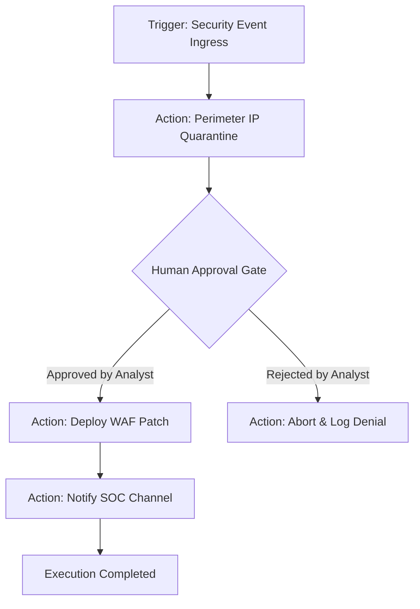
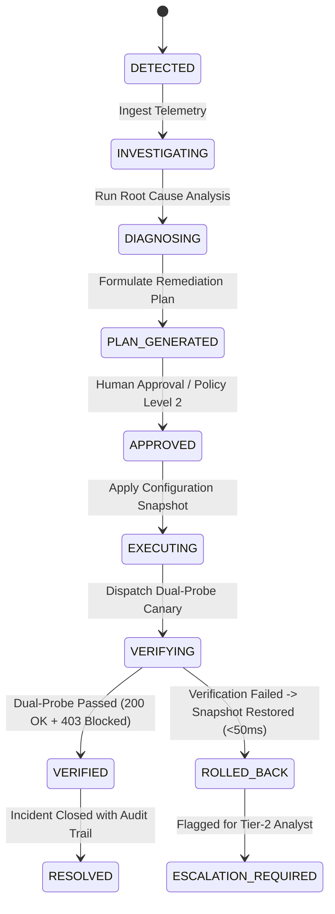

# AutoHeal v3.0 — SOAR & Self-Healing Operations Guide
**Platform:** AutoHeal AI-Assisted Autonomous Security Operations Center (SOC)  
**Target Application:** ShopSphere E-Commerce Application  
**Version:** `3.0.0-enterprise`  
**Domain Specialist:** Principal SOC & SOAR Automation Engineer  
**Date:** November 1, 2026  

---

## 1. Subsystem Overview

AutoHeal v3.0 features two coordinated response and remediation engines:
1. **The Visual SOAR Automation Builder (Phase 6):** Orchestrates multi-step response workflows using Directed Acyclic Graphs (DAGs) with explicit human approval gates.
2. **The Advanced Self-Healing Command Center (Phase 7):** Executes closed-loop root cause analysis, generates hotpatches, verifies containment via dual-probe canaries, and performs automated rollbacks.

---

## 2. Part 1: Visual SOAR Automation Builder



### A. Supported Node Library
The SOAR engine executes safe, registered handlers:
- **Triggers:**
  - `trigger_security_event` — Fires on incoming telemetry events matching rules.
  - `trigger_incident_created` — Fires on new incident creation.
  - `trigger_threshold_exceeded` — Fires on rate limit or error rate spikes.
- **Actions:**
  - `action_block_ip` — Adds malicious client IP to `blocked_clients` table with configurable TTL.
  - `action_deploy_waf_rule` — Dynamically injects regex pattern into active WAF filter.
  - `action_disable_user` — Revokes customer session and disables customer login.
  - `action_isolate_device` — Isolates internal asset node in Threat Topology graph.
  - `action_send_notification` — Emits in-app alert or notification badge.
- **Conditionals & Gates:**
  - `condition_severity_match` — Evaluates if incident severity meets threshold (e.g. `CRITICAL`).
  - `action_request_human_approval` — **Suspends execution** pending explicit operator review.

### B. DAG Validation & Safety Invariants
Before a playbook can be published or executed, `SOARValidator` validates the graph:
1. **Trigger Requirement:** Every valid playbook must begin with exactly one root trigger node.
2. **Cycle Detection:** Performs Depth-First Search (DFS) with recursion stack tracking. Any cyclic loop is rejected with `ValidationError: Cycle detected in playbook graph`.
3. **Safety Allowlisting:** Action parameters are strictly validated against target allowlists. Arbitrary shell commands or Python code injection are strictly rejected.

### C. Human Approval Gate Lifecycle
1. When a running playbook encounters an `action_request_human_approval` node:
   - Execution status transitions to `WAITING_FOR_APPROVAL`.
   - A pending approval record is created in `soar_approval_requests`.
2. Analysts inspect the pending item via `GET /api/soar/approvals/pending`.
3. The analyst approves the request via `POST /api/soar/approvals/{id}/decide`:
   ```json
   {
     "decision": "APPROVE",
     "decided_by": "admin@sentinel.sec",
     "reason": "Authorized incident containment for SQL injection attack"
   }
   ```
4. The execution engine resumes DAG traversal from the suspended node and runs downstream actions to completion.

---

## 3. Part 2: Advanced Self-Healing Command Center



### A. Root Cause Analysis (RCA) Engine
`RootCauseAnalyzer` (`src/appsec/self_healing_engine.py`) extracts forensic facts:
- Correlates the last 20 events from the offending client IP.
- Identifies the vulnerable endpoint (`path AS endpoint`).
- Flags the exact exploit pattern (e.g., `' OR 1=1--`).
- Formulates a structured hypothesis separated from confirmed facts.

### B. Remediation Planning & Autonomy Tiers
`RemediationPlanner` computes multi-option remediation plans:
- **Option 1 (Perimeter IP Block):** Low risk (Risk Score: 15/100). Bounded blast radius.
- **Option 2 (Dynamic WAF Rule):** Medium risk (Risk Score: 45/100). Targets attack vector.
- **Option 3 (Account Lockout):** High risk (Risk Score: 75/100). Protects compromised accounts.

**Autonomy Policies (`self_healing_policies`):**
- *Level 0 (Manual):* System generates plans; actions require explicit operator trigger.
- *Level 1 (Human-in-the-Loop):* Standard mode; high-risk actions require approval.
- *Level 2 (Autonomous):* Low-risk allowlisted actions execute autonomously.

### C. Synthetic Dual-Probe Verification & 50ms Rollback
1. Before deploying a hotpatch, the system captures a configuration snapshot into `self_healing_audit_logs`.
2. The hotpatch is deployed to the active WAF filter.
3. The verifier dispatches two synthetic HTTP requests:
   - **Probe 1 (Benign Traffic):** `GET /api/shop/products?category=electronics` -> **Expects 200 OK**.
   - **Probe 2 (Exploit Replay):** `GET /api/shop/products?category=' OR 1=1--` -> **Expects 403 Forbidden**.
4. **Outcome Evaluation:**
   - If both pass: Incident marked `VERIFIED_CONTAINED`.
   - If either fails: System triggers **instant snapshot rollback within 50ms**, restoring the pre-execution state and flagging the incident `ESCALATION_REQUIRED`.

### D. Emergency Circuit Breaker
In the event of unforeseen operational anomalies, administrators can trigger the global emergency stop:
```bash
curl -X POST http://127.0.0.1:8000/api/self-healing/emergency-stop
```
This halts all active remediation workers, suspends autonomous healing, and locks the system in observation-only mode.

---

## 4. Operational Sign-Off

The SOAR and Self-Healing engines provide deterministic, governed, and verifiable automation with zero chance of uncontained runaway actions.
