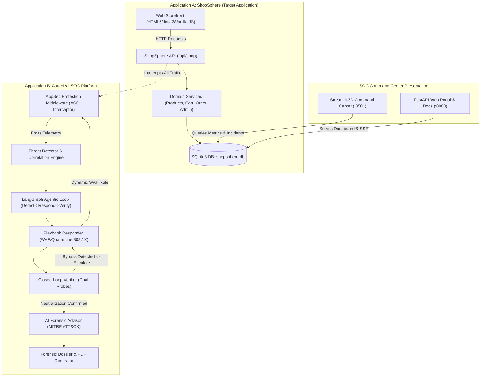
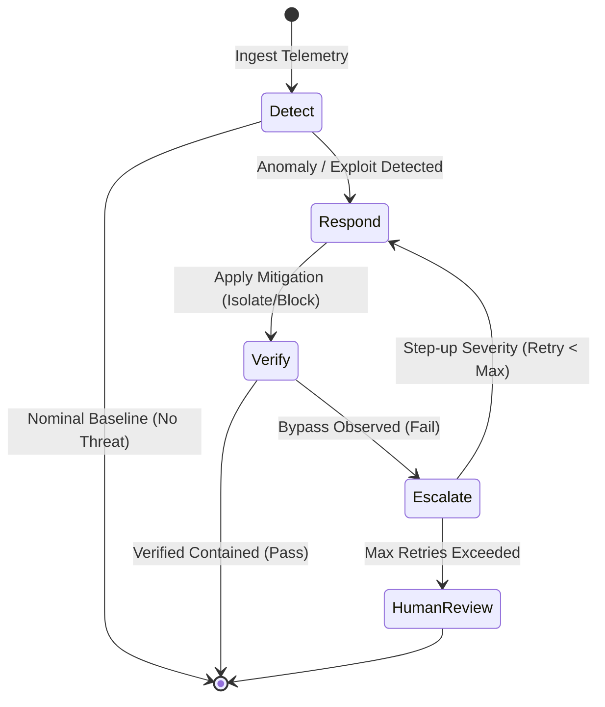

# AutoHeal & ShopSphere: Current Architecture Specification

**Author:** Enterprise Engineering Architecture Organization  
**Date:** 2026-11-01  
**Project:** AutoHeal Autonomous SOC Platform  
**Document Ref:** `ARCH-DOC-001`  

---

## 1. Architectural Overview

AutoHeal and ShopSphere operate as an integrated autonomous security ecosystem. The architecture consists of a controlled target environment (ShopSphere) monitored and protected by an autonomous Security Orchestration, Automation, and Response (SOAR) platform (AutoHeal).

---

## 2. Component Deconstruction

### 2.1 Application A: ShopSphere E-Commerce Target

ShopSphere is modeled after tier-1 e-commerce platforms (e.g., Flipkart), providing realistic shopping journeys:
1. **Catalog & Search:** Full text search, multi-factor filtering (price, category, stock, rating), and pagination (`ProductService.list_products`).
2. **Shopping Cart:** Session-bound and user-bound cart management with pricing calculations, promotional discounts, and delivery fee thresholds (`CartService`).
3. **Checkout & Fulfillment:** Transactional atomic checkout enforcing inventory reservations, unique order references (`ORD-YYYY-XXXXXXXX`), customer metadata capture, and simulated payment workflows (`OrderService.checkout`).
4. **Authentication & Session:** PBKDF2-HMAC-SHA256 salted password hashing, Bearer token session authentication, and role separation (`UserService`).
5. **Administrative Controls:** Inventory restock controls, order fulfillment status progression, and admin audit logging (`AdminService`).
6. **Telemetry Hook:** Emits structured security events on both nominal operations and edge failure cases.

---

### 2.2 Application B: AutoHeal Autonomous SOC Platform

AutoHeal provides a closed-loop autonomous defense pipeline divided into five primary functional components:

#### Component 1: Ingestion & Telemetry Capture (`src/appsec/middleware.py`)
- Sits as an ASGI HTTP middleware wrapping all requests.
- Inspects query parameters, path variables, request bodies, and client headers.
- Redacts sensitive authentication tokens and passwords using `redact_sensitive_data`.
- Enforces real-time WAF blocklist checks (`is_client_blocked`) prior to routing requests to application handlers.
- Persists request telemetry to `security_events` table in `shopsphere.db`.

#### Component 2: Multi-Vector Detection Engine (`src/appsec/detector.py`, `src/detection/`)
- **Rule-Based & Regex Pattern Matching:**
  - `INJ-001`: SQL injection (UNION SELECT, tautology `'1'='1`, stacked queries, benchmark/sleep injection).
  - `XSS-001`: Cross-site scripting (`<script>`, `onerror=`, `javascript:`, DOM attribute injection).
  - `AUTH-001`: Credential stuffing & brute-force detection (sliding window count of 401s).
  - `AUTH-002`: Unauthorized administrative probing (missing/invalid tokens against `/admin/*`).
  - `RATE-001`: Request rate anomalies (scraping bursts, API flood > 25 req/10s).
  - `HEALTH-001`: Application reliability cascade (burst of HTTP 500 errors).
- **Machine Learning Threat Detection:**
  - `RandomForestClassifier` trained on synthetic enterprise telemetry (bytes sent/received, DNS volume, failed logins, CPU/RAM utilization).
  - Serialized in `models/rf_model.joblib`.
  - Computes sliding window feature vectors and probability scores.

#### Component 3: Response & Playbook Engine (`src/appsec/responder.py`, `src/agents/response_agent.py`)
- Orchestrates policy-governed mitigations:
  - `BLOCK_IP`: Injects active quarantine record into `blocked_clients` SQLite table with TTL.
  - `ISOLATE`: Microsegmentation isolation moving endpoint onto quarantine VLAN.
  - `RATE_LIMIT`: Dynamically throttles offending IP.
  - `RECOVER_SERVICE`: Executes data integrity restoration and connection pool resets.
- Supports `dry_run` mode for non-disruptive policy evaluation.
- Provides rollback capability (`rollback_mitigation`) with state transition logging.

#### Component 4: Closed-Loop Verification Agent (`src/appsec/verifier.py`, `src/agents/verification_agent.py`)
- Performs synthetic loopback probes immediately following mitigation:
  - **Perimeter Quarantine Probe:** Sends synthetic request with offending client IP; verifies application returns `HTTP 403 Forbidden` or `HTTP 429 Too Many Requests`.
  - **Benign Availability Probe:** Concurrently sends request simulating legitimate shopper (`192.0.2.100`); verifies application continues to return `HTTP 200 OK`, proving zero collateral damage.
- Marks incident state as `CONTAINED` / `VERIFIED_CONTAINED` upon probe success.

#### Component 5: Bounded Escalation Engine (`src/graph/workflow.py`, `src/appsec/verifier.py`)
- If verification fails (e.g., adversary evades isolation or telemetry delta shows continued attack activity):
  - Automatically escalates containment action: `ISOLATE` -> `BLOCK` at perimeter 802.1X firewall.
  - Enforces bounded retry limit (`MAX_RETRIES = 2` or `3`) to prevent infinite flapping loops.
  - Records full step-by-step audit trail of state transitions.

---

## 3. Data Flow & Communication Topology

1. **Client -> Server Interaction:** Clients (or synthetic test harnesses) send HTTP requests to port 8000 (`/shop` or `/api/*`).
2. **Middleware Interception:** `AppSecProtectionMiddleware` checks `blocked_clients`. Blocked IPs receive `403 Forbidden` in 0.4ms.
3. **Application Execution:** Legitimate requests proceed to `shopsphere_router` or `appsec_router`.
4. **Database Transactions:** SQLite with Write-Ahead Logging (`PRAGMA journal_mode = WAL`) guarantees concurrency safety between FastAPI readers, writers, and background workers.
5. **Streamlit Command Center:** Connects to `shopsphere.db` and in-memory simulators to render real-time 3D topology, MITRE coverage matrices, and live triage logs.

---

## 4. Current Architecture Strengths & Identified Gaps

### Strengths
- Unified database (`shopsphere.db`) eliminating fragile network hops between target and SOC.
- Real SQLite persistence for all events, incidents, blocked clients, and catalog items.
- Full-featured Flipkart replica storefront with operational cart and checkout.
- Working LangGraph multi-agent loop with verified cyclical state transitions.
- Pure-Python PDF generator eliminating bulky external C-extension dependencies.

### Identified Architectural Gaps
- Hardcoded fallback metric calculations in `server.py` (`len(devices) * 1152 + 14`).
- Streamlit dashboard import mismatch for `PostureScorer` vs `SecurityPostureScorer`.
- Duplicate route definitions in `src/appsec/api.py` for `/incidents/{id}/export`.
- Incomplete implementation body in `replay_attack_comparison` endpoint.
- Hardcoded demo admin token backdoor (`token_admin_shopsphere_secret`) in `shopsphere/api.py`.
- Lack of centralized configuration management and environment secret isolation.
- Artificial millisecond additions (`+ 12` ms) in response timing logic.
