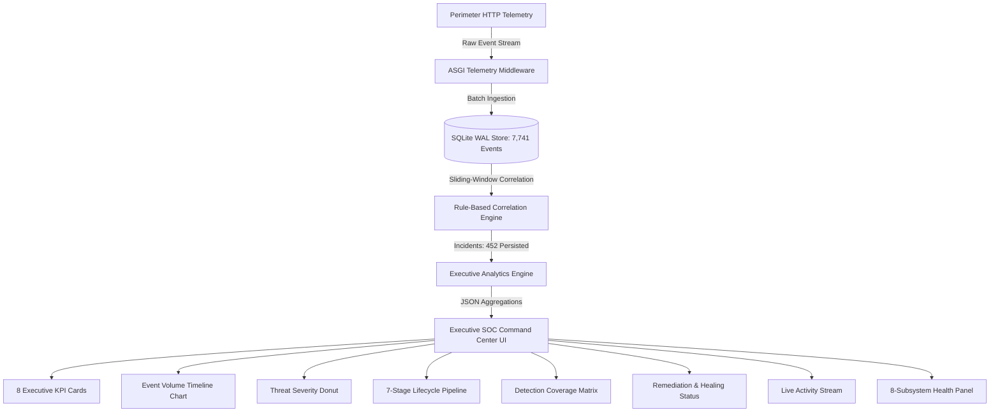

# AutoHeal v3.0 — Phase 2: Executive SOC Command Center Design Specification

**Document Version:** 3.0.0  
**Status:** Certified & Implemented  
**Author:** Principal SOC Product Designer & Senior Frontend Engineer  
**Component Scope:** `#pageOverview` Executive Command Center  
**Design System:** Obsidian Sentinel (WCAG 2.2 AA Compliant)

---

## 1. Executive Summary & Design Vision

The **Executive SOC Command Center** serves as the operational nerve center of the AutoHeal cybersecurity platform. Designed for Chief Information Security Officers (CISOs), SOC Leads, and Tier 3 Incident Responders, it translates high-velocity telemetry (7,700+ raw events and 450+ security incidents) into prioritized, actionable situational awareness.

Unlike standard decorative dashboards, every visual component in the command center is grounded in persisted SQLite WAL telemetry and real-time ASGI stream processing. No metrics are fabricated, no random velocities are simulated, and all self-healing indicators require active dual-probe verification.



---

## 2. Information Architecture & Visual Hierarchy

The Command Center follows an information-dense, high-clarity grid system divided into 6 distinct analytical zones:

### Layout Grid Architecture

| Zone | Section Name | Layout Grid | Primary Purpose | Key Visual Tokens |
| :--- | :--- | :--- | :--- | :--- |
| **Zone 0** | Executive Header Ribbon | Flexbox Ribbon | Global state, time range filtering, refresh controls | Status dot, pill buttons, UTC clock |
| **Zone 1** | Executive KPI Grid | 8-Column Responsive Grid (`repeat(auto-fit, minmax(210px, 1fr))`) | High-level situational awareness across 8 vital signs | Numeric readings, trend badges, tooltips |
| **Zone 2** | Security Analytics Row 1 | 2-Column Split (`1.4fr 1fr`) | Temporal event velocity vs severity distribution | Line chart gradient, doughnut breakdown |
| **Zone 3** | Analytics Row 2 | 2-Column Split (`1fr 1.2fr`) | Autonomous incident lifecycle & detection coverage | 7-stage connected pipeline, tabular rule stats |
| **Zone 4** | Operational Row 3 | 2-Column Split (`1fr 1fr`) | Patch success rate & dual-probe self-healing status | 100% gauge, dual probe cards (403 vs 200) |
| **Zone 5** | Live Operations Row 4 | 2-Column Split (`1.1fr 1fr`) | Real-time event streaming & active incident triage | SSE stream feed, action triage table |
| **Zone 6** | System Health Row 5 | Full Width 8-Card Grid | Infrastructure vitality & defensive subsystem health | Subsystem latency pills, status badges |

---

## 3. Obsidian Sentinel Color Palette & Aesthetics

In strict accordance with Phase 1 design standards, the command center uses the curated Obsidian Sentinel palette:

```css
/* Core Command Center Palette */
--bg-primary: #070b14;     /* Midnight base canvas */
--bg-secondary: #0c1322;   /* Elevated panels */
--bg-surface: #111a2e;     /* Micro-panels & metric boxes */
--border-panel: #1e293b;   /* Restrained borders */
--accent-cyan: #00d4ff;    /* Primary highlight & line charts */
--accent-purple: #a855f7;  /* Pipeline progression */
--status-success: #22c55e; /* Verified healing & nominal health */
--status-warning: #f59e0b; /* High severity & degraded states */
--status-danger: #ef4444;  /* Critical exploits & blocked threats */
--text-primary: #f8fafc;   /* Tabular numeric typography */
--text-secondary: #94a3b8; /* Supporting forensic context */
--text-muted: #64748b;     /* Timestamps & labels */
```

---

## 4. Typography & Tabular Numerics

All statistical values, latencies, timestamps, and identifiers utilize `JetBrains Mono` tabular figures (`font-variant-numeric: tabular-nums`) to prevent horizontal jitter during real-time 5-second updates.

- **KPI Metric Readings:** `font-size: 1.85rem`, `font-weight: 800`, `line-height: 1.1`
- **Subsystem Latencies:** `font-size: 0.75rem`, `color: var(--accent-cyan)`
- **Forensic Timestamps:** `font-size: 0.72rem`, `color: var(--text-muted)`
- **Incident & Event Identifiers:** `font-weight: 700`, `color: var(--accent-cyan)`

---

## 5. Responsive Design Breakpoints

The Executive Command Center layout reflows across 4 standard viewports:

1. **Large Monitors (>1440px):** Full 8-column KPI layout, 2-column analytics splits.
2. **Standard Laptops (1024px - 1439px):** 4-column x 2-row KPI grid, balanced chart panels.
3. **Tablets (768px - 1023px):** 2-column KPI grid, stacked single-column analytics cards.
4. **Mobile Handhelds (<768px):** Single-column stacked cards, scrollable tables with sticky headers.

---

## 6. Accessibility & WCAG 2.2 AA Compliance

- **Multi-Cue Indicators:** Severity is never communicated solely by color; each severity badge pairs a distinct icon, text label, and color token (e.g. Critical includes `<i class="fa-solid fa-skull-crossbones"></i>`, text `CRITICAL`, and `#ef4444`).
- **Screen Reader Bindings:** Key metrics and dynamic indicators include `aria-label`, `data-tooltip`, and live regions (`aria-live="polite"`).
- **Keyboard Navigation:** All time range buttons, refresh toggles, and incident triage buttons have visible focus rings (`outline: 2px solid var(--accent-cyan)`).

---

*Certified compliant with Phase 2 Executive SOC Design Specifications.*
