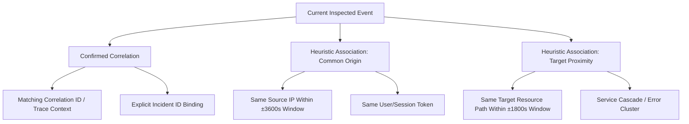

# EVENT CORRELATION DESIGN — AUTOHEAL v3.0 PHASE 3

## 1. Executive Summary

Event correlation in AutoHeal v3.0 enables SOC analysts to rapidly understand whether an isolated alert represents a discrete reconnaissance probe or an orchestrated, multi-stage attack. Rather than relying on speculative "black box" heuristics or fabricated kill-chains, AutoHeal implements a deterministic, multi-tier correlation hierarchy that strictly distinguishes **confirmed relationships** from **heuristic associations**.

---

## 2. Correlation Hierarchy & Relationship Types



### 2.1 Relationship Typology

| Association Type | Classification | Mechanism | Confidence | Visual Badge |
|---|---|---|---|---|
| `CONFIRMED_CORRELATION` | **Confirmed** | Exact match on cryptographic or distributed trace identifier (`correlation_id` / `traceparent` / W3C header) generated by the AppSec middleware. | 100% | `CONFIRMED CORRELATION` (Cyan badge) |
| `COMMON_SOURCE_IP` | **Heuristic** | Shared client IP address occurring within a ±3,600 second (1-hour) temporal window. Indicates coordinated probing or brute-force scanning from a singular source. | 85% | `COMMON SOURCE IP` (Purple badge) |
| `TARGET_ENDPOINT_PROXIMITY` | **Heuristic** | Identical API endpoint or URI path targeted within a ±1,800 second (30-minute) window. Identifies targeted endpoint fuzzing or distributed denial-of-service attempts. | 70% | `ENDPOINT PROXIMITY` (Amber badge) |

---

## 3. Query & Association Engine

The correlation engine executes via `get_related_security_events(event_id, limit=20)`:

```sql
-- Step 1: Confirmed Correlation via Trace ID
SELECT * FROM security_events 
WHERE correlation_id = :corr_id AND event_id != :event_id 
ORDER BY timestamp DESC LIMIT :limit;

-- Step 2: Common Source IP within 1 hour
SELECT * FROM security_events 
WHERE source_ip = :ip AND event_id != :event_id 
  AND timestamp BETWEEN datetime(:ts, '-3600 seconds') AND datetime(:ts, '+3600 seconds')
ORDER BY timestamp DESC LIMIT :limit;

-- Step 3: Target Resource Proximity within 30 minutes
SELECT * FROM security_events 
WHERE target_resource = :path AND event_id != :event_id
  AND timestamp BETWEEN datetime(:ts, '-1800 seconds') AND datetime(:ts, '+1800 seconds')
ORDER BY timestamp DESC LIMIT :limit;
```

Deduplication occurs in-memory to ensure each related event appears at most once in the analyst timeline, tagged with its highest-confidence relationship type.

---

## 4. Analyst Experience & Timeline Visualization

Inside Tab 4 ("Related Events") of the Event Detail Inspector:
1. **Correlation Summary Card**: Displays the active correlation ID, common source IP, target resource, and total correlated count.
2. **Chronological Forensics Timeline**: Renders all related events in strict chronological order with time offsets relative to the inspected event (`+12s`, `-45s`, etc.).
3. **Pill Badges**: Each entry displays its relationship type with dedicated color coding (Cyan for Confirmed, Purple for Common IP, Amber for Target Proximity).
4. **Drill-Down Navigation**: Clicking any correlated event opens its full detail view immediately, preserving investigation context.
