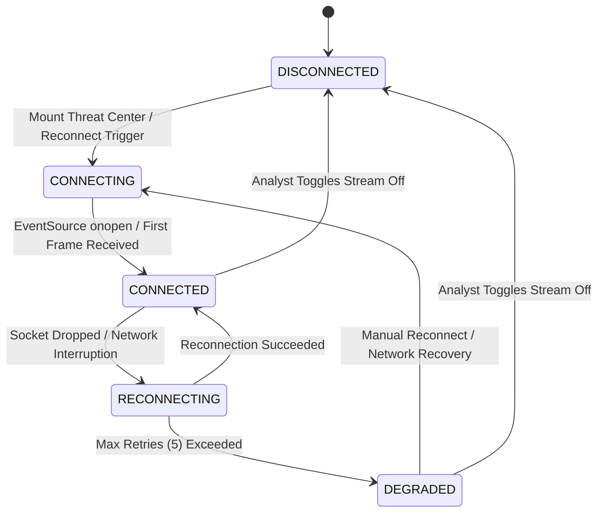

# EVENT STREAM ARCHITECTURE — AUTOHEAL v3.0 PHASE 3

## 1. Executive Summary

The AutoHeal v3.0 Live Threat Center features a real-time event streaming pipeline designed to stream sub-second telemetry from detection pipelines directly to SOC analyst browser interfaces. Built on **Server-Sent Events (SSE)** with zero-loss fallback polling, the architecture guarantees continuous situational awareness without fabricating events or claiming false real-time fidelity.

---

## 2. Real-Time Streaming Architecture

```mermaid
flowchart TD
    subgraph Ingestion & Detection
        A[Inbound HTTP Traffic] --> B[AppSec Middleware / WAF Engine]
        B --> C[Detection Rules INJ-001 ... RATE-001]
        C --> D[(SQLite: security_events)]
        C --> E[FastAPI Background Event Dispatcher]
    end

    subgraph Backend Stream Delivery
        E --> F[GET /api/security/events/stream]
        F --> G[Async Generator with Heartbeat]
    end

    subgraph Frontend Client Controller
        G -- SSE Stream --> H[EventSource Connection]
        H --> I{Connection Monitor}
        I -- Connected --> J[Deduplication Filter]
        I -- Stream Error / Drop --> K[Exponential Backoff / Reconnect]
        K -- Max Retries Exceeded --> L[Fallback Poller (5s Cadence)]
        L --> J
        J --> M[Bounded Buffer (Max 30 Events)]
        M --> N[DOM Renderer with .table-row-new Animation]
    end
```

---

## 3. Streaming Protocol Specification

### 3.1 Endpoint
- **URL**: `GET /api/security/events/stream`
- **Media-Type**: `text/event-stream`
- **Cache-Control**: `no-cache, no-transform`
- **Connection**: `keep-alive`

### 3.2 SSE Event Wire Format

#### Telemetry Event Frame
```http
event: security_event
data: {
  "event_id": "EVT-20261101-9F8A",
  "timestamp": "2026-11-01T11:42:15.120Z",
  "event_type": "SQL_INJECTION_ATTEMPT",
  "severity": "CRITICAL",
  "source_ip": "198.51.100.42",
  "target_resource": "/api/v1/products?category=1%27+OR+%271%27%3D%271",
  "action_taken": "BLOCKED",
  "rule_id": "INJ-001",
  "rule_name": "SQL Injection Attack Vector",
  "investigation_status": "UNREVIEWED"
}
```

#### Heartbeat / Keepalive Frame
Sent every 3 seconds to prevent timeout across reverse proxies (Nginx/Cloudflare) and browser socket teardowns:
```http
event: ping
data: {"time": "2026-11-01T11:42:18.000Z"}
```

---

## 4. Connection State Machine

The client implements an immutable 4-state Finite State Machine (FSM). The UI **never** reports `LIVE` unless an active, verified stream is established.



### State Indicators and Badges
| State | CSS Class | Badge Text | Description |
|---|---|---|---|
| `CONNECTED` | `live-status-pill.connected` | `● LIVE (STREAM)` | Active HTTP SSE stream delivering live events. Glowing emerald pulse. |
| `RECONNECTING` | `live-status-pill.reconnecting` | `◌ RECONNECTING` | Backoff retry in progress (1s, 2s, 4s, 8s, 15s max). Amber badge. |
| `DEGRADED` | `live-status-pill.degraded` | `▲ DEGRADED (POLLING)` | SSE failed; automatic 5-second REST polling fallback engaged. Warning amber. |
| `DISCONNECTED` | `live-status-pill.disconnected` | `✕ STREAM PAUSED` | Stream manually paused or halted. Muted slate badge. |

---

## 5. Client Buffer Management & Deduplication

### 5.1 Deduplication Cache
- A sliding memory set (`seenLiveEventIds`) retains the last 500 observed event IDs.
- Any frame whose `event_id` is already in the set is immediately discarded, preventing duplicate table rows during stream reconnects or concurrent polling transitions.

### 5.2 Bounded Buffer
- Real-time events are appended to a volatile buffer of maximum 30 items.
- If the table is currently on Page 1, incoming events are prepended to the top of `#eventsTableBody`.
- Excess rows exceeding the display limit are truncated from the bottom to prevent DOM bloat and browser memory leaks.

### 5.3 Live Pause & Resume
- Analysts can toggle the stream pause switch at any time.
- When paused, the connection remains established, but new events are queued in a secondary FIFO buffer without mutating the active DOM, allowing forensic review of specific records without layout shifting.

### 5.4 Visual Arrival Animation
- Newly arrived rows receive the `.table-row-new` CSS class, producing a subtle 2.5-second cyan-to-transparent highlight gradient that draws analyst attention without causing eye fatigue.

---

## 6. Resilience and Fault Recovery

1. **Network Interruptions**: Automatic exponential backoff reconnection up to 5 attempts.
2. **Server Restarts**: The client gracefully catches HTTP 502/503/504 errors and drops into `DEGRADED` polling until the backend service returns HTTP 200.
3. **Database Locks**: SQLite WAL (Write-Ahead Logging) mode allows concurrent reader streams while the ingestion worker commits batches.
4. **Proxy Compatibility**: Pings sent at 3000ms intervals prevent HTTP 504 Gateway Timeouts on corporate proxies.
