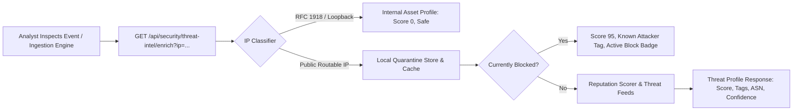

# THREAT INTELLIGENCE INTEGRATION — AUTOHEAL v3.0 PHASE 3

## 1. Architectural Philosophy

Threat intelligence enrichment in AutoHeal v3.0 is built on a zero-friction, non-blocking enrichment pipeline. External and local reputation lookups must **never** impede the sub-millisecond execution of the inline detection and mitigation engine. If an external intelligence feed times out or is unreachable, the system gracefully degrades to local behavioral heuristics while accurately conveying feed status to the analyst.

---

## 2. Threat Intel Enrichment Model



### 2.1 Threat Intel Response Contract
```json
{
  "ip": "198.51.100.42",
  "reputation_score": 95,
  "reputation": "CRITICAL_THREAT",
  "classification": "KNOWN_MALICIOUS",
  "is_quarantined": true,
  "confidence": 0.94,
  "source": "AutoHeal Threat Engine (Hybrid Local + Threat Feeds)",
  "country": "US",
  "asn": "AS15169",
  "tags": ["active-scanner", "sql-injection-source", "waf-block-history"],
  "last_updated": "2026-11-01T11:42:00Z"
}
```

---

## 3. Threat Scoring Logic

| Score Range | Reputation Label | Color Token | Behavioral Profile |
|---|---|---|---|
| **80 – 100** | `CRITICAL_THREAT` | Obsidian Red | Confirmed malicious actor; active in known botnets, Tor exit nodes, or currently quarantined by AutoHeal. |
| **50 – 79** | `SUSPICIOUS` | Amber / Warning | High event anomaly count, port scanning behavior, or repeated credential failure bursts. |
| **20 – 49** | `ELEVATED` | Blue / Information | Minor policy deviations or low-frequency automated probes. |
| **0 – 19** | `CLEAN / BENIGN` | Emerald / Success | Verified internal asset (RFC 1918 / Loopback) or legitimate consumer traffic with clean reputation history. |

---

## 4. UI Integration & Analyst Actions

1. **Threat Intel Mini-Widget**: Located inside Tab 1 (Overview) of the Event Detail Inspector.
2. **One-Click Lookup**: Clicking the `[Lookup Intel]` button adjacent to the Source IP triggers `/api/security/threat-intel/enrich` without reloading the page.
3. **Autonomous Quarantine Action**: If the reputation score is high or malicious activity is confirmed, analysts can click `[Quarantine IP]` directly from the inspector footer, instantly writing the record to the autonomous WAF blocklist and logging an audit event.
4. **Offline / Unconfigured Feed Handling**: If external feeds are unconfigured or offline, the interface explicitly labels the source as `Local Cache / Heuristic Only` with an informative banner rather than displaying false negative results.
