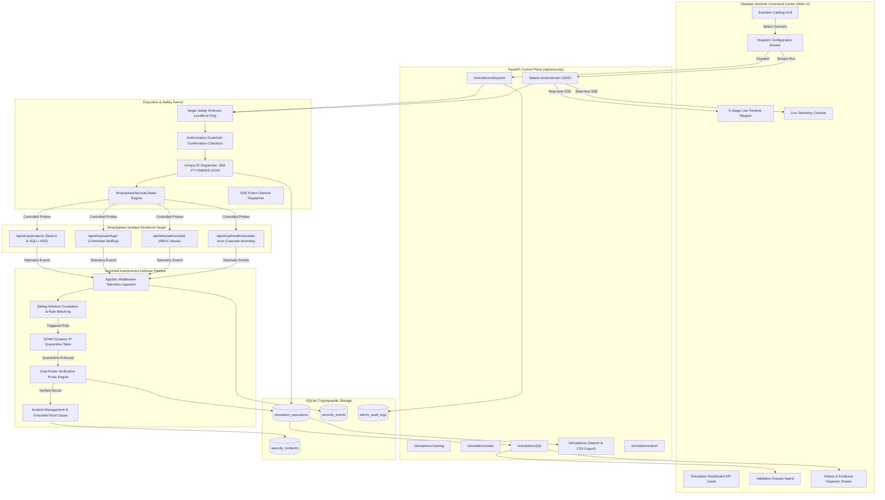

# Attack Simulation Center Architecture (Phase 4)
## AutoHeal Sentinel v3.0 — Advanced Defensive Testing & Containment Benchmarking

### 1. Executive Summary & Objective

The **Attack Simulation Center (ASC)** is AutoHeal Sentinel's authorized defensive security testing suite. It bridges offensive simulation and autonomous defense by providing a controlled environment to benchmark detection rules, validate SIEM event ingestion pipelines, measure SOAR containment latency, and collect cryptographically verifiable evidence.

Rather than relying on visual-only demonstrations or uncalibrated mock generators, the Attack Simulation Center executes real HTTP security probes against the local ShopSphere application within an isolated environment, monitors real-time detection rule firing, tracks autonomous dynamic quarantine, and validates perimeter containment using dual-probe verification.

---

### 2. Architectural Blueprint & Component Topology

---

### 3. Core Architectural Modules

#### 3.1 Scenario Catalog Subsystem
- Maintains a registry of 7 verified, executable adversarial test scenarios.
- Exposes comprehensive scenario metadata: Scenario ID, Name, Description, Risk Category, Severity, Expected Detection Rule, Expected Policy Action, MITRE ATT&CK technique mapping, and estimated runtime.
- Strictly couples UI representations to backend implementations; no scenario is visible unless executable.

#### 3.2 Target Safety & Authorization Guardrails
- **Kernel-level Target Allowlisting (`validate_target_safety`)**: Intercepts every simulation request before execution. Rejects any target URL whose hostname is not `localhost`, `127.0.0.1`, `0.0.0.0`, `::1`, or `testserver` with an immediate HTTP 400 `TargetSafetyError`.
- **Defensive Testing Certification**: Requires operator confirmation via `#simAuthConfirmationCheck` certifying authorized local defensive benchmarking.
- **Payload Safety**: Only permits safe boolean probes (e.g. `' OR '1'='1`) and script reflection tokens (``), preventing destructive commands, drop operations, or lateral movement.

#### 3.3 Simulation Execution Engine
- Generates immutable execution IDs following the standard `SIM-YYYYMMDD-XXXX` pattern.
- Supports both **Live Mode** (active HTTP transmission + real-time detection + dynamic quarantine) and **Dry-Run Mode** (heuristic simulation of policy matching without network requests).
- Collects fine-grained execution metrics: start time, end time, duration in milliseconds, total HTTP requests sent, requests blocked, and error states.
- Implements operator abort capabilities via `POST /api/security/simulations/abort` which gracefully signals active threads and closes event streams.

#### 3.4 Telemetry & Live Monitor Stepper
- Utilizes an enterprise 5-stage sequential stepper:
  1. **Stage 1 (Dispatch)**: Target allowlist validation and authorization certification.
  2. **Stage 2 (Transmission)**: Controlled HTTP packet dispatch against ShopSphere endpoints.
  3. **Stage 3 (Detection)**: Event ingestion, signature correlation, and detection rule trigger.
  4. **Stage 4 (Quarantine)**: SOAR dynamic firewall quarantine applied to source IP.
  5. **Stage 5 (Verification)**: Dual-probe validation (attacker probe returns 403, benign shopper returns 200).
- Delivers real-time execution logs through a streaming Server-Sent Events (SSE) pipe with an automatic REST polling fallback.

#### 3.5 Dual-Column Validation Dossier Matrix
- Contrasts expected baseline detection signatures against actual triggered rules.
- Computes definitive detection outcomes:
  - `DETECTED`: Expected rule matched actual rule.
  - `NOT_DETECTED`: Threshold not reached or rule did not trigger.
  - `PARTIALLY_DETECTED`: Related rule triggered but did not match expected rule ID.
  - `EXECUTION_FAILED`: Target unreachable or unexpected internal exception.
- Validates containment through dual-probe metrics: verifies attacker IP receives HTTP 403 Forbidden while benign shopper traffic continues receiving HTTP 200 OK without collateral damage.

#### 3.6 Forensic Evidence Center & History Ledger
- Slide-over 640px forensic evidence drawer (`#simulationEvidenceDrawer`) displaying raw step traces, request latency, matched detection signatures, and cryptographically formatted JSON artifacts.
- Searchable and multi-filterable history ledger supporting compound filtering by scenario, status, and outcome with server-side pagination and formula-safe CSV export.
