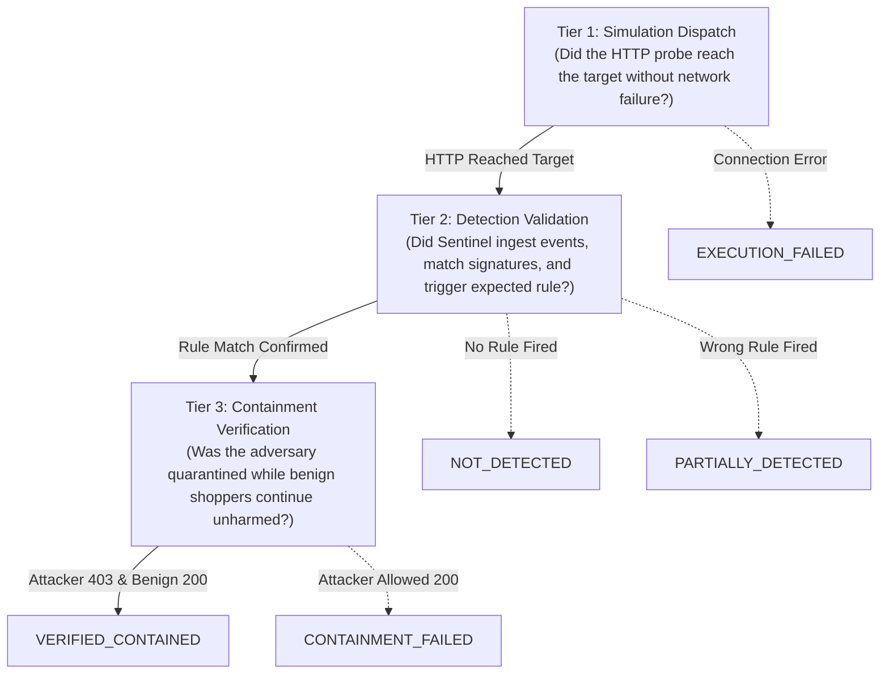

# Detection & Remediation Validation Framework (Phase 4)
## AutoHeal Sentinel v3.0 — Rigorous Detection Benchmarking & Containment Verification

### 1. Conceptual Framework: The 3-Tier Verification Model

A fundamental flaw in naive attack simulators is equating HTTP request delivery with defensive validation. In AutoHeal Sentinel, testing is governed by a **strict 3-Tier Verification Hierarchy**:



---

### 2. Detection Outcome State Taxonomy

The detection engine evaluates incoming telemetry against expected scenario signatures to produce one of five mutually exclusive outcomes:

| Outcome State | Semantic Meaning | Technical Condition | UI Presentation |
| :--- | :--- | :--- | :--- |
| `DETECTED` | Complete Detection Pass | `actual_rule_id == expected_rule_id` and rule triggered | Green Badge (`badge-success`) |
| `PARTIALLY_DETECTED` | Partial Anomaly Detection | An anomaly or secondary rule fired, but did not match expected rule ID | Yellow Badge (`badge-warning`) |
| `NOT_DETECTED` | Defensive Blind Spot | No detection rule fired; threshold window was not reached | Red Badge (`badge-critical`) |
| `EXECUTION_FAILED` | Simulation Transmission Failure | Target refused connection, timed out, or internal error | Red Badge (`badge-critical`) |
| `VALIDATION_FAILED` | Integrity Mismatch | Detection telemetry was recorded but failed cryptographic or format validation | Gray Badge (`badge-neutral`) |

---

### 3. Dual-Probe Remediation & Containment Architecture

AutoHeal Sentinel does not consider an incident remediated merely because a firewall script executed. Containment is verified using a **Dual-Probe Empirical Check**:

```mermaid
sequenceDiagram
    autonumber
    participant Engine as Execution Engine
    participant Proxy as Unified AppSec Middleware
    participant Target as ShopSphere API
    participant Attacker as Attacker Probe (203.0.113.88)
    participant Benign as Benign Shopper (192.0.2.1)

    Engine->>Proxy: Dispatch Adversarial Probe (e.g. SQLi / Failed Logins)
    Proxy->>Target: Ingest & Correlate Telemetry
    Target-->>Proxy: Rule Fired -> Insert Attacker IP to Quarantined Table
    
    rect rgb(40, 20, 20)
        Note over Engine,Proxy: Probe A: Adversary Perimeter Verification
        Engine->>Proxy: Probe A with X-Forwarded-For: 203.0.113.88
        Proxy-->>Engine: HTTP 403 Forbidden (Dynamic Quarantine Active)
    end

    rect rgb(20, 40, 20)
        Note over Engine,Proxy: Probe B: Benign Shopper Collateral Verification
        Engine->>Proxy: Probe B with X-Forwarded-For: 192.0.2.1
        Proxy->>Target: Forward Legitimate Shopper Request
        Target-->>Proxy: HTTP 200 OK (Product Catalog Rendered)
        Proxy-->>Engine: HTTP 200 OK (Zero Collateral Impact)
    end

    Note over Engine: VERDICT: TARGET SECURED (protection_verified=true)
```



#### 3.1 Mathematical Containment Matrix

$$\text{Containment Verification} = (\text{Status}_{\text{Attacker}} \in \{403, 429\}) \land (\text{Status}_{\text{Benign}} = 200)$$

If the attacker is blocked ($403$) but the benign shopper is also blocked ($403$), AutoHeal flags **Collateral Damage / Over-Enforcement**. 

Only when the dual-probe passes simultaneously is `protection_verified` set to `True`.

---

### 4. Detection Validation Dossier Schema

When a simulation completes, a structured dossier is generated:

```json
{
  "execution_id": "SIM-20261101-9F1A",
  "scenario_id": "sqli",
  "detection_outcome": "DETECTED",
  "protection_verified": true,
  "validation_matrix": {
    "detection": {
      "expected_rule": "INJ-001",
      "actual_rule": "INJ-001",
      "rule_match": true,
      "outcome": "DETECTED",
      "confidence": 0.96
    },
    "remediation": {
      "action_executed": "BLOCK_IP (Dynamic Quarantine)",
      "protection_verified": true,
      "attacker_probe_blocked": true,
      "attacker_probe_status": 403,
      "benign_probe_status": 200
    }
  },
  "incident_id": "INC-20261101-INJ1",
  "duration_ms": 782.4
}
```

This structure is directly rendered by `#simValidationInspectorCard` in the UI to give security analysts immediate visual clarity.
