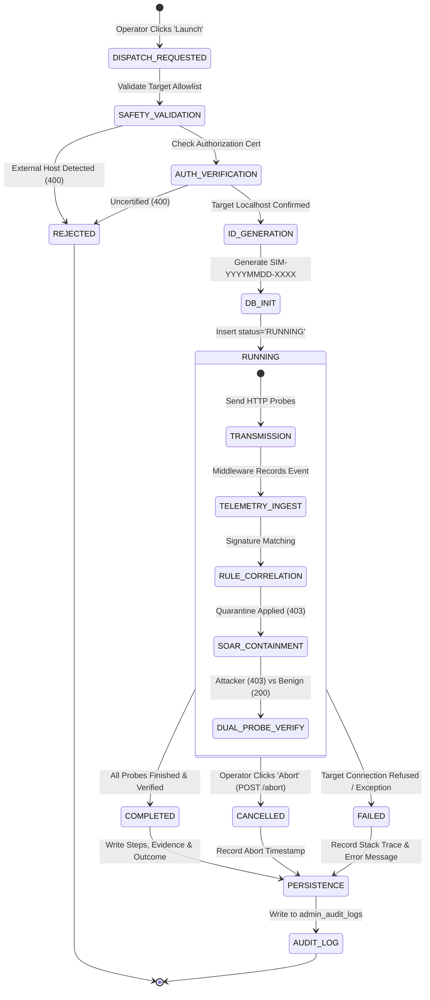

# Simulation Execution Engine Specification (Phase 4)
## AutoHeal Sentinel v3.0 — Controlled Adversarial Testing Kernel

### 1. Engine Overview & Architecture

The **Simulation Execution Engine** orchestrates controlled security tests within the AutoHeal platform. It translates operator configurations into non-destructive HTTP attacks, streams telemetry to the frontend via Server-Sent Events (SSE), monitors downstream detection firing, triggers autonomous SOAR quarantine, and commits immutable audit records to the database.

---

### 2. Execution Lifecycle & Finite State Machine

---

### 3. Execution Identification Standard

Every security test generated by AutoHeal is assigned a globally unique, cryptographically random, timestamped Execution ID:

$$\text{Execution ID Format} = \text{SIM}-\text{YYYYMMDD}-\text{HEX}_6$$

**Example IDs**:
- `SIM-20261101-9F1A`
- `SIM-20261101-A42F01`
- `SIM-20261101-885162`

**Properties**:
- **Immutability**: Once recorded in `simulation_executions`, the execution ID cannot be modified.
- **Traceability**: All security events generated during the test carry this ID in their context or correlation ID.
- **Dossier Association**: Incidents escalated as a result of the simulation reference the parent execution ID in their evidence summary.

---

### 4. Execution Modes: Live vs Dry-Run

| Attribute | Live Simulation Mode (`live`) | Dry-Run Benchmark Mode (`dryrun`) |
| :--- | :--- | :--- |
| **Network Requests** | Transmits actual HTTP GET/POST packets to ShopSphere endpoints | Zero network requests sent |
| **Target Requirement** | Requires active ShopSphere HTTP or in-process ASGI testserver | Offline capable |
| **Detection Firing** | Real-time signature trigger via `AppSecMiddleware` and `AppSecDetector` | Heuristic evaluation against scenario signature catalog |
| **Firewall Action** | Inserts actual client IP into SQLite `quarantined_clients` table | Simulated quarantine status recorded |
| **Verification Probe** | Dual probes sent (attacker probe + benign shopper probe) | Heuristic verification recorded |
| **Average Duration** | 500ms – 1800ms depending on attempt count | ~45ms |
| **Primary Use Case** | True end-to-end detection benchmarking and SOC verification | Rapid CI/CD pipeline checks and policy syntax testing |

---

### 5. Operator Cancellation & Abort Mechanics

Security operations teams require the absolute ability to stop an active simulation immediately if unexpected latency occurs or if an error cascade is detected.

1. **Abort Trigger**: Operator clicks **Abort Test** (`#btnStopAttack`) in the console, firing `POST /api/security/simulations/abort`.
2. **Global Flag Toggle**: Engine toggles thread-safe `_active_test_cancelled = True`.
3. **Execution Loop Interruption**: Loop iterations in `stream_test_execution` check `is_test_cancelled()` before each packet dispatch.
4. **SSE Event Emission**: Yields `{"type": "cancelled", "message": "Simulation aborted by operator."}`.
5. **Database Finalization**: Updates execution row with `status='CANCELLED'`, `detection_outcome='EXECUTION_FAILED'`, records abort duration, and writes an audit log entry.

---

### 6. Streaming vs Polling Fallback Architecture

- **Primary Pipeline (SSE Stream)**:
  - Client connects to `EventSource('/api/security/attack-center/stream?scenario=...&mode=live')`.
  - Server yields structured SSE JSON frames:
    - `phase`: Notifies UI of stage transitions (`ATTACK_EXECUTION`, `DEFENSE_INTERCEPT`, `VERIFICATION_PROBE`).
    - `request`: Dispatches individual probe latency, method, and HTTP status code.
    - `detection`: Transmits triggered detection rule ID, confidence, severity, and mitigation action.
    - `verification`: Delivers dual-probe outcomes (HTTP 403 vs 200).
    - `complete`: Emits final execution summary, execution ID, and duration.
- **Secondary Pipeline (REST Polling Fallback)**:
  - If SSE is unavailable (e.g. corporate proxy drops persistent HTTP chunked streams), the frontend automatically detects `EventSource.onerror` and falls back to `POST /api/security/simulations/dispatch`.
  - The dispatch API completes synchronously in 400ms – 1500ms and returns the full execution record, immediately hydrating the 5-stage stepper and Validation Dossier.
