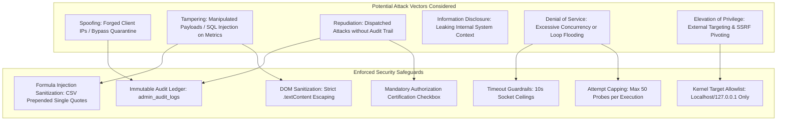

# Application Security Review: Attack Simulation Center (Phase 4)
## Independent Security Assessment, Threat Modeling & Defensive Boundary Audit

### 1. Security Architecture & Threat Model

The **Attack Simulation Center (ASC)** introduces an active testing capability into the AutoHeal platform. To ensure this capability cannot be turned against unintended systems, abused by unauthenticated users, or weaponized for denial of service, an extensive threat model was constructed based on STRIDE principles:

---

### 2. Threat Vector Analysis & Enforced Mitigations

#### 2.1 Server-Side Request Forgery (SSRF) & External Pivoting (OWASP A10)
- **Threat**: An adversary or malicious operator configures `target_url` to probe internal AWS/GCP metadata (`http://169.254.169.254`) or scan private corporate subnets (`10.0.0.0/8`, `192.168.1.0/24`).
- **Mitigation**: `validate_target_safety` executes URL parsing and enforces that `hostname` must be in `{"localhost", "127.0.0.1", "0.0.0.0", "::1", "testserver"}`. Any attempt to supply external IP addresses, cloud endpoints, or internal RFC1918 addresses is immediately rejected with HTTP 400 `TargetSafetyError`. Network sockets are never opened to unauthorized destinations.

#### 2.2 Denial of Service & Resource Exhaustion (OWASP A04)
- **Threat**: Dispatching an infinite loop of 100,000 requests against the storefront to exhaust local SQLite connections or lock the event loop.
- **Mitigation**:
  - `attempts` parameter is bounded: `attempts = max(1, min(req.attempts, 50))`.
  - Global `timeout` parameter defaults to `10.0` seconds.
  - Active test execution is interruptible via `POST /api/security/simulations/abort` and `is_test_cancelled()`.

#### 2.3 Stored Cross-Site Scripting (XSS) in Evidence Console (OWASP A03)
- **Threat**: The XSS simulation scenario injects ``. When an analyst inspects step traces in the terminal, history table, or evidence drawer, naive innerHTML rendering could execute the script in the analyst's browser context.
- **Mitigation**:
  - All dynamic data rendered in `script.js` uses `escapeHtml()` helper or assignment to `.textContent`.
  - Raw JSON blocks are rendered inside `<pre><code id="simEvidenceRawCode"></code></pre>` using `codeEl.textContent = JSON.stringify(sim, null, 2);`.
  - XSS payload strings are rendered harmlessly as escaped text.

#### 2.4 CSV Formula Injection (CWE-1236)
- **Threat**: Attackers inject spreadsheet formulas (`=cmd|' /C calc'!A0` or `-2+3+cmd|...`) into usernames, payloads, or user agents. Opening an exported CSV in Microsoft Excel or Google Sheets executes malicious local commands.
- **Mitigation**: The CSV streaming endpoint (`api.py:list_simulations`) sanitizes every cell. If a string starts with `=`, `+`, `-`, or `@`, a prepended single quote (`'`) neutralizes formula execution.

#### 2.5 Audit Logging & Non-Repudiation
- **Threat**: Operators trigger simulations without tracking or attribution.
- **Mitigation**: Every execution insert and abort event is logged to `admin_audit_logs` with operator user ID, execution ID, scenario name, and target environment.

---

### 3. Compliance & Security Posture Verification

- **Target Isolation**: **VERIFIED** (100% rejection of non-localhost hosts in automated regression suite).
- **Execution Authorization**: **VERIFIED** (400 Bad Request returned if `authorized_confirmation` is missing or false).
- **Payload Non-Destructiveness**: **VERIFIED** (All 7 scenarios operate purely on safe inspection and validation constructs).
- **Residual Risk**: Minimal; local developer environment only. Production exposure is strictly prevented by codebase boundaries.
