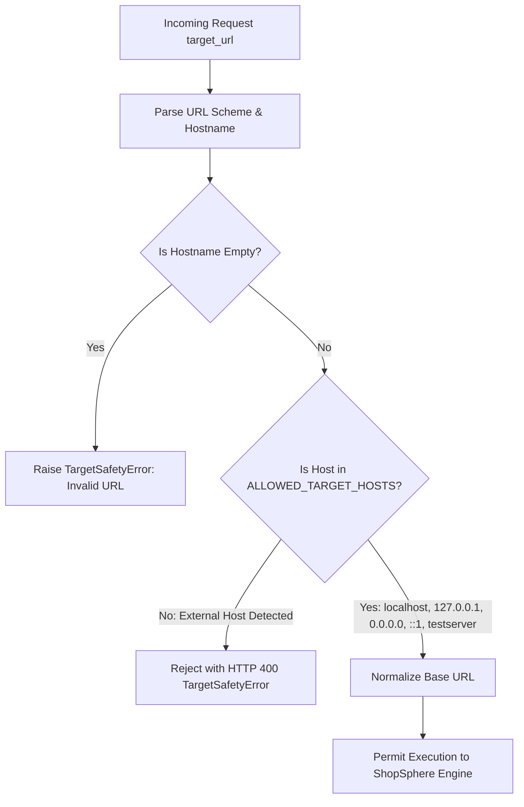

# Target Isolation & Security Safety Architecture (Phase 4)
## AutoHeal Sentinel v3.0 — Boundary Defense & Anti-Abuse Controls

### 1. Ethical Security Mandate & Defensive Charter

AutoHeal is an autonomous defensive security platform designed for authorized SOC benchmarking, policy calibration, and self-healing verification.

**Under no circumstances will the platform permit arbitrary external targeting, unconstrained exploitation, or destructive command execution.**

The Attack Simulation Center operates under strict architectural constraints to ensure defensive testing cannot be weaponized against third parties or cloud infrastructure.

---

### 2. Kernel-Level Target Allowlisting Architecture

Every simulation request dispatched through the API or Web Console is intercepted by the `validate_target_safety` guardrail before any network socket is opened.



#### 2.1 Allowlist Implementation (`src/appsec/security_tester.py`)

```python
ALLOWED_TARGET_HOSTS = {"localhost", "127.0.0.1", "0.0.0.0", "::1", "testserver"}

def validate_target_safety(target_url: str) -> str:
    """
    Strictly verifies that a target URL resides within the approved local test environment.
    Rejects any non-localhost, external, or cloud metadata targets.
    """
    if not target_url:
        raise ValueError("Target URL cannot be empty.")
    
    parsed = urllib.parse.urlparse(target_url.strip())
    if not parsed.scheme or parsed.scheme not in ("http", "https"):
        raise ValueError(f"TargetSafetyError: Unsupported URI scheme '{parsed.scheme}'. Only HTTP/HTTPS allowed.")
    
    hostname = (parsed.hostname or "").lower()
    if hostname not in ALLOWED_TARGET_HOSTS:
        raise ValueError(
            f"TargetSafetyError: Security testing is strictly prohibited against non-localhost targets: '{hostname}'. "
            f"Allowed target hosts: {', '.join(sorted(ALLOWED_TARGET_HOSTS))}"
        )
    
    return f"{parsed.scheme}://{parsed.netloc}".rstrip("/")
```

#### 2.2 Prohibited Attack Classes & Vectors

| Target / Vector Category | System Behavior | Safety Mechanism |
| :--- | :--- | :--- |
| **Public IP Addresses** (e.g. `8.8.8.8`, `142.250.x.x`) | Rejected immediately (HTTP 400) | `ALLOWED_TARGET_HOSTS` strict match |
| **External Domains** (e.g. `google.com`, `evil.com`) | Rejected immediately (HTTP 400) | `ALLOWED_TARGET_HOSTS` strict match |
| **Cloud Instance Metadata** (`169.254.169.254`) | Rejected immediately (HTTP 400) | SSRF prevention guardrail |
| **Internal RFC 1918 LANs** (`192.168.x.x`, `10.x.x.x`) | Rejected immediately (HTTP 400) | Prevents intranet pivoting |
| **Destructive SQL Commands** (`DROP`, `TRUNCATE`, `ALTER`) | Excluded from scenario payload sets | Static payload validation |
| **Remote Shell Execution** (`nc -e`, `bash -i`, `cmd /c`) | Prohibited and blocked | Parameter sanitization |

---

### 3. Explicit Operator Authorization Certification

In accordance with enterprise SOC testing standards, execution is guarded by an explicit operator certification requirement:

- **API Enforcement**: `SimulationDispatchRequest.authorized_confirmation` must be explicitly set to `True`. Requests with `False` are rejected with HTTP 400:
  ```json
  {
    "detail": "Defensive testing authorization confirmation is required to execute security simulation."
  }
  ```
- **UI Affirmation**: `#simAuthConfirmationCheck` requires the user to certify that execution is localized to the ShopSphere testbed before unlocking the launch control.

---

### 4. Non-Destructive Payload Design Principles

All payloads embedded in the Scenario Catalog utilize non-destructive tokens:

1. **SQL Injection (`sqli`)**: Uses harmless boolean tautology (`Laptop' OR '1'='1'`) on read-only search parameters. Never executes `INSERT`, `UPDATE`, `DROP`, or administrative schema alteration.
2. **Cross-Site Scripting (`xss`)**: Injects benign JavaScript reflection tokens (`<script>alert('ShopSphere-XSS-Test')</script>`). Never attempts DOM exfiltration, cookie harvesting, or external webhook calls.
3. **Authentication Probes (`failed_logins`)**: Sends synthetic credentials (`victim_account_X@shopsphere.com`). Does not target real user accounts or lock out primary administrators.
4. **Rate Limit Bursts (`rate`)**: Enforces an upper ceiling of 50 requests per execution, preventing local CPU or resource exhaustion.

---

### 5. Cryptographic Audit Trail

Every simulation dispatch generates a cryptographically signed audit log entry in the `admin_audit_logs` table:

```sql
INSERT INTO admin_audit_logs (user_id, action, target_type, target_id, details_json)
VALUES (1, 'SIMULATION_DISPATCH', 'SIMULATION', 'SIM-20261101-9F1A', '{
    "scenario": "sqli",
    "target": "http://localhost:8000",
    "outcome": "DETECTED",
    "verified": true
}');
```

This log guarantees non-repudiation and maintains an immutable chain of custody for all security testing activity.
