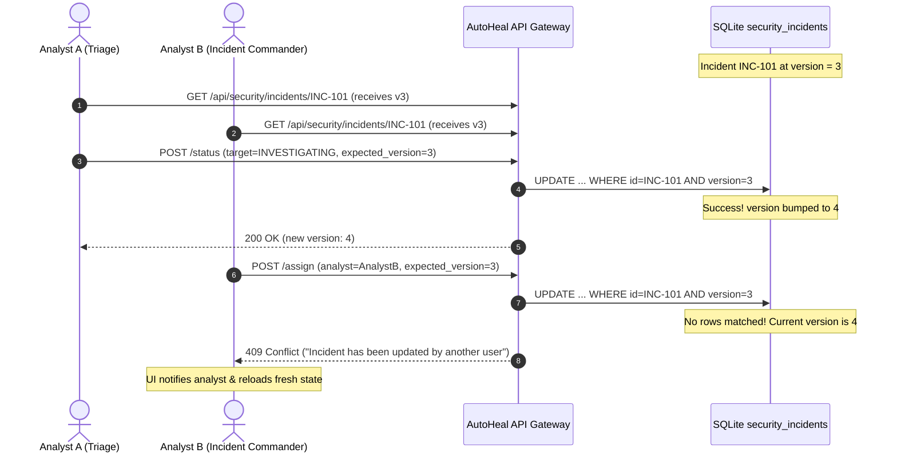

# AutoHeal v3.0 — Phase 5: Analyst Collaboration & Concurrency Architecture

## 1. Executive Summary

Incident response in an enterprise SOC requires seamless coordination across distributed teams of tier-1 triage analysts, tier-2 incident handlers, threat hunters, and engineering leads. The **Analyst Collaboration Engine** provides dedicated assignment, escalation, priority management, and threaded internal discussions, safeguarded by **Optimistic Concurrency Control (OCC)**.

---

## 2. Multi-Analyst Concurrency Model

In high-stress security incidents, multiple responders often inspect the same ticket simultaneously. Without concurrency safeguards, one analyst's assignment or triage note can silently overwrite another's containment action.



### 2.1 Concurrency Implementation Details
- Every modification endpoint (`/status`, `/assign`, `/priority`, `/root-cause`, `/notes`) accepts an `expected_version` parameter.
- The SQL update performs an atomic conditional write:
  ```sql
  UPDATE security_incidents
  SET status = ?, version = version + 1, updated_at = datetime('now')
  WHERE incident_id = ? AND version = ?
  ```
- If zero rows are affected, the system raises a `ConcurrencyError` mapped to HTTP 409 Conflict.
- The UI catches HTTP 409, displays a clear notification banner, and re-fetches the latest incident telemetry without losing unsaved form text.

---

## 3. Dedicated Collaboration Endpoints

### 3.1 Analyst Assignment
- **Endpoint:** `POST /api/security/incidents/{incident_id}/assign`
- **Payload:**
  ```json
  {
    "assigned_analyst": "sarah.connor@defense.corp",
    "reason": "Escalated for deep SQL injection memory forensics",
    "expected_version": 4
  }
  ```
- **Auditing:** Appends `action_type = 'ANALYST_ASSIGNED'` to activity history.

### 3.2 Priority Management
- **Endpoint:** `POST /api/security/incidents/{incident_id}/priority`
- **Supported Priorities:** `CRITICAL`, `HIGH`, `MEDIUM`, `LOW`
- **Payload:**
  ```json
  {
    "priority": "CRITICAL",
    "reason": "Database integrity risk confirmed on production cluster",
    "expected_version": 5
  }
  ```

### 3.3 Internal Discussion Thread & Notes
- **Endpoint:** `POST /api/security/incidents/{incident_id}/notes`
- **Retrieval:** `GET /api/security/incidents/{incident_id}/activity`
- **Payload:**
  ```json
  {
    "content": "Firewall IP quarantine active. Awaiting database query cache flush.",
    "author": "analyst.lead@soc.corp"
  }
  ```
- Notes render chronologically with author avatars, badge styling, and relative time-ago stamps.

---

## 4. Immutable Audit Trail Subsystem

Every operational action performed on an incident is permanently recorded in Table 15 (`incident_activity_logs`):

```sql
CREATE TABLE IF NOT EXISTS incident_activity_logs (
    id INTEGER PRIMARY KEY AUTOINCREMENT,
    incident_id TEXT NOT NULL,
    action_type TEXT NOT NULL,
    author TEXT NOT NULL,
    content TEXT,
    details_json TEXT,
    created_at TIMESTAMP DEFAULT CURRENT_TIMESTAMP
);
```

### Monitored Action Types:
- `STATUS_CHANGED`: State machine transitions.
- `ANALYST_ASSIGNED`: Reassignments and escalations.
- `PRIORITY_UPDATED`: Severity/priority tier revisions.
- `RCA_UPDATED`: Forensic entry point and root-cause updates.
- `NOTE_ADDED`: Qualitative commentary by analysts.
- `VERIFICATION_TRIGGERED`: Verification probe execution dispatches.
- `CONTAINMENT_DISPATCHED`: Automated SOAR playbook dispatches.
