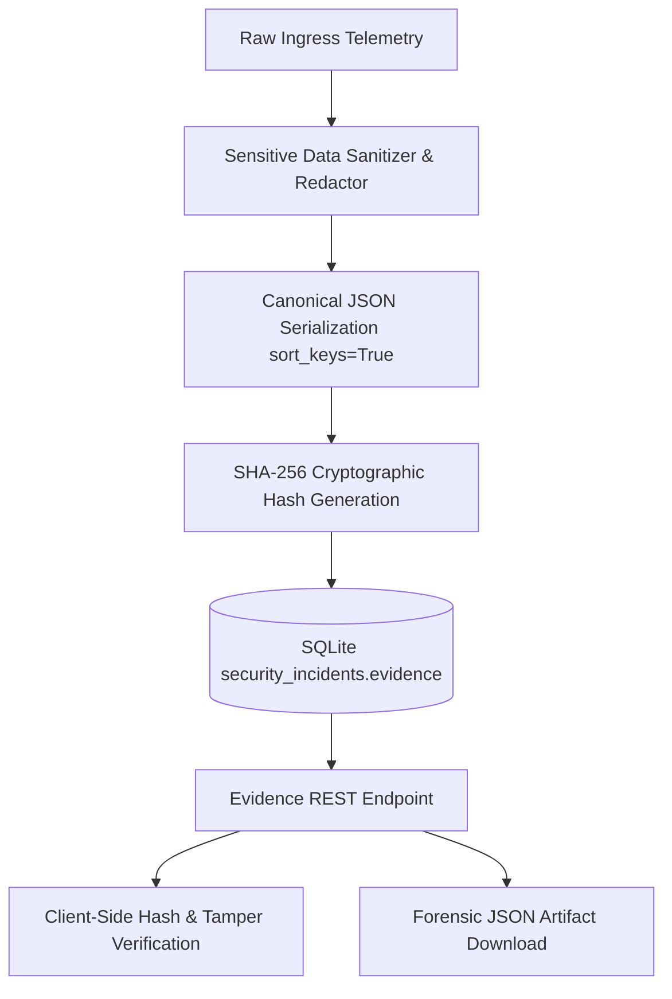

# AutoHeal v3.0 — Phase 5: Digital Evidence Management & Cryptographic Integrity

## 1. Overview

In digital forensics and incident response, evidence must withstand legal, regulatory, and technical scrutiny. The AutoHeal v3.0 Digital Evidence Explorer provides end-to-end evidence custody, cryptographic integrity validation, automated sensitive data redaction, and tamper-evident logging.

---

## 2. Evidence Ingestion & Normalization

Evidence artifacts originate from three authoritative telemetry streams:
1. **ShopSphere Ingress Middleware:** Captures raw HTTP request line, headers, query parameters, and request body upon anomalous request detection.
2. **Detection & Correlation Engine:** Records detection rule metrics, signature matches, anomaly scores, and trigger conditions.
3. **Attack Simulation Center:** Pairs simulated exploit payloads with recorded target responses to isolate adversarial mechanics.



---

## 3. Cryptographic Tamper-Evidence Algorithm

To guarantee evidence has not been modified post-incident creation, AutoHeal computes an immutable SHA-256 digest at ingestion:

```python
import hashlib
import json

def generate_evidence_digest(evidence_payload: dict) -> str:
    """Computes a deterministic SHA-256 checksum over normalized, sorted JSON."""
    canonical_json = json.dumps(evidence_payload, sort_keys=True, separators=(",", ":"))
    return hashlib.sha256(canonical_json.encode("utf-8")).hexdigest()
```

### Verification Pipeline:
1. **Ingress:** Normalized JSON is hashed and stored alongside incident records.
2. **Retrieval (`GET /api/security/incidents/{id}/evidence`):** The backend re-hashes stored JSON and compares it against expected metadata.
3. **UI Display:** The Digital Evidence Explorer renders a cryptographic integrity badge:
   - `TAMPER_EVIDENT: VALID (SHA-256: 7f83b165...)` in glowing Emerald `#10b981`.
   - Any corruption or mutation triggers an amber/red discrepancy alert.

---

## 4. Automated Sensitive Data Redaction

Prior to forensic storage or display, automated redaction scrubs PII, secrets, and credential artifacts:
- **Authorization Headers:** Replaced with `Bearer [REDACTED_TOKEN]`.
- **Passphrases & Secrets:** Passwords, API keys, and session cookies are replaced with `[REDACTED_CREDENTIAL]`.
- **Payment Information:** Credit card numbers and CVV codes matched by regex patterns are masked to `****-****-****-XXXX`.
- **Safe Serialization:** Ensures redacted payloads maintain schema structure without leaking plaintext credentials.

---

## 5. Security & Safe Rendering Standards

To prevent cross-site scripting (XSS) and code injection via malicious payloads stored in security logs:
- **Zero `innerHTML` Usage:** All evidence headers, request bodies, and query parameter strings are rendered strictly via `document.createElement` and `node.textContent`.
- **Sanitized JSON Formatting:** Payloads are formatted via `JSON.stringify(data, null, 2)` inside dedicated `<pre><code>` blocks with explicit CSS word-break rules.
- **Copy & Download Controls:**
  - `Copy JSON`: Copies serialized evidence directly to the system clipboard using the modern Clipboard API with graceful fallback.
  - `Download JSON`: Generates a localized `Blob` (`application/json`) downloaded as `incident-{id}-evidence.json` with audit logging of the export action.
