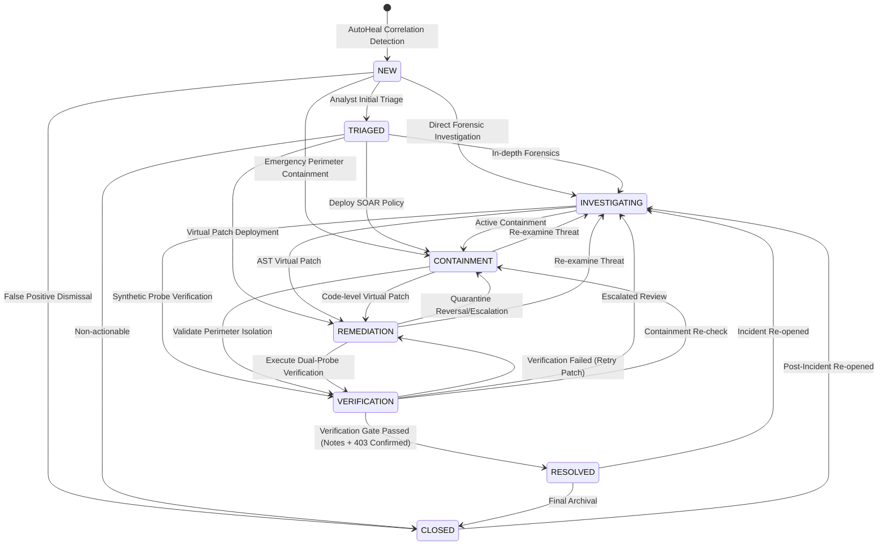

# AutoHeal v3.0 — Phase 5: Incident Lifecycle Implementation

## 1. Lifecycle State Machine Specification

The AutoHeal v3.0 incident lifecycle follows an 8-state deterministic finite state machine designed to reflect NIST SP 800-61r2 and ISO/IEC 27035 incident handling guidelines. State transitions are strictly validated in the backend engine (`src.appsec.models.transition_incident_status`).



---

## 2. Transition Validity Matrix

| Current State | Permitted Target States | Prerequisites / Validation Checks |
| :--- | :--- | :--- |
| `NEW` | `TRIAGED`, `INVESTIGATING`, `CONTAINMENT`, `CLOSED` | None (initial triage entry) |
| `TRIAGED` | `INVESTIGATING`, `CONTAINMENT`, `REMEDIATION`, `CLOSED` | Assigned analyst recorded |
| `INVESTIGATING` | `CONTAINMENT`, `REMEDIATION`, `VERIFICATION` | Root-cause review active |
| `CONTAINMENT` | `REMEDIATION`, `VERIFICATION`, `INVESTIGATING` | Defensive SOAR action recorded |
| `REMEDIATION` | `VERIFICATION`, `CONTAINMENT`, `INVESTIGATING` | Virtual patch or policy enacted |
| `VERIFICATION` | `RESOLVED`, `REMEDIATION`, `INVESTIGATING`, `CONTAINMENT` | **Resolution Gate Check** (see Section 3) |
| `RESOLVED` | `CLOSED`, `INVESTIGATING` | Verified resolution metadata present |
| `CLOSED` | `INVESTIGATING` | Re-open requires justification in audit log |
| `OPEN` (Legacy) | `INVESTIGATING`, `CONTAINMENT`, `RESOLVED` | Backward-compatibility mapped |

Any attempt to execute an invalid transition (e.g., `NEW -> RESOLVED` without containment or verification) is rejected immediately with HTTP 400 Bad Request:
```json
{
  "detail": "Invalid incident lifecycle transition from 'NEW' to 'RESOLVED'. Allowed next states from 'NEW': TRIAGED, INVESTIGATING, CONTAINMENT, CLOSED."
}
```

---

## 3. The Resolution Operational Security Gate

Under no circumstances may an incident be marked as `RESOLVED` purely because an automation returned status 200 or an analyst clicked a button. AutoHeal enforces an operational security gate with two strict prerequisites:

### Prerequisite A: Verification State Gate
The incident's `verification_status` column in SQLite must equal `VERIFIED_CONTAINED` or `VERIFIED_RECOVERED`. If the verification state is `PENDING`, `FAILED`, or `DEGRADED`, the transition is rejected:
```json
{
  "detail": "Cannot mark incident RESOLVED: Verification state is 'PENDING'. Independent dual-probe verification must confirm containment or recovery prior to resolution."
}
```

### Prerequisite B: Mandatory Resolution Documentation
The analyst must submit non-empty, actionable `resolution_notes` articulating:
1. Root cause summary.
2. Defensive containment and remediation actions executed.
3. Verification probe results confirming perimeter blockage and zero false-positive disruption.

If `resolution_notes` is null, whitespace, or omitted, HTTP 400 is raised:
```json
{
  "detail": "Resolution notes are strictly required before marking an incident as RESOLVED."
}
```

When both prerequisites are fulfilled, the engine atomically stamps:
- `resolved_at = datetime('now')`
- `resolved_by = author`
- `resolution_notes = resolution_notes.strip()`
- `status = 'RESOLVED'`
- `version = version + 1`
And appends an immutable audit event of type `STATUS_CHANGE` to `incident_activity_logs`.

---

## 4. Optimistic Concurrency Control

To prevent race conditions when multiple SOC analysts collaborate on the same incident, `security_incidents` incorporates a numeric `version` integer column (default `1`).

### Workflow:
1. The client workspace fetches the incident dossier, receiving `version: 3`.
2. When the analyst submits a status change, analyst assignment, priority change, or root-cause finding, the client includes `"current_version": 3`.
3. The backend executes an atomic check:
   ```python
   if expected_version is not None and curr_version != expected_version:
       raise ConcurrencyError(
           f"Concurrency Conflict: Incident {incident_id} is at version {curr_version}, but update expected version {expected_version}."
       )
   ```
4. If a concurrent analyst has incremented the version to 4, the update aborts, returning HTTP 409 Conflict:
   ```json
   {
       "detail": "Concurrency Conflict: Incident INC-2026-947C95C6 is at version 4, but update expected version 3."
   }
   ```
5. The frontend displays an alert prompting the analyst to refresh and review the concurrent modifications.
