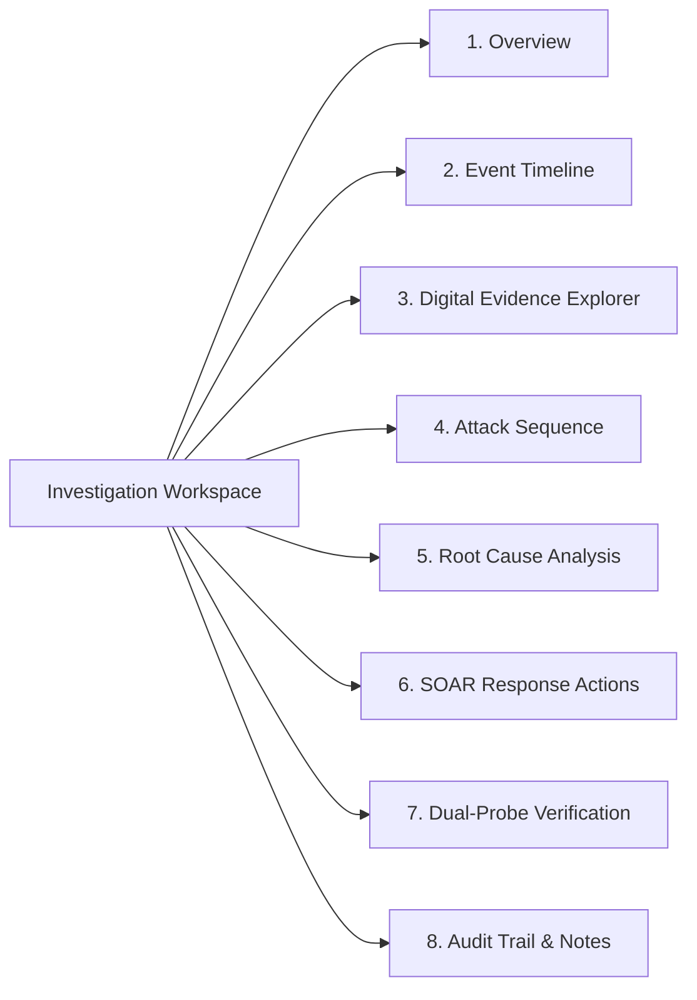

# AutoHeal v3.0 — Phase 5: Incident Investigation Workspace Architecture & Specification

## 1. Executive Summary

The **Incident Investigation Workspace** (`#incidentDetailWorkspace`) is the deep-forensics cockpit within the AutoHeal v3.0 Incident Command Center. It provides cybersecurity analysts with a contextual, unified interface to dissect security incidents without losing their position in the incident triage table.

Adhering strictly to the **Obsidian Sentinel** visual standard, the workspace seamlessly combines real-time telemetry, cryptographic verification badges, interactive timelines, and SOAR response controls into a high-density, low-latency single-page architecture.

---

## 2. Workspace Layout & Topology

```
+---------------------------------------------------------------------------------------------------+
|  [Sticky Workspace Header]                                                                        |
|  Incident ID | Title | Severity Badge | Priority Badge | Status Badge | Version | Close Button    |
|  Action Buttons: [Change Status] [Assign Analyst] [Update Priority]                               |
+---------------------------------------------------------------------------------------------------+
|  [Telemetry Summary Strip]                                                                        |
|  Rule ID | Affected Target | Attacker IP | Correlation Events | Simulation ID | Updated At        |
+---------------------------------------------------------------------------------------------------+
|  [Navigation Tabs Bar]                                                                            |
|  [Overview] [Timeline] [Evidence] [Attack Seq] [Root Cause] [SOAR Actions] [Verification] [Notes] |
+---------------------------------------------------------------------------------------------------+
|  [Active Tab Content Pane - Dynamic Lazy Render]                                                  |
|                                                                                                   |
|  (Renders dedicated content module depending on active tab selection)                             |
|                                                                                                   |
+---------------------------------------------------------------------------------------------------+
```

### 2.1 Sticky Workspace Header
- **Incident Identity:** Displays the permanent `incident_id` (e.g., `INC-20261101-AUTH-001`) with copy-to-clipboard functionality.
- **Dynamic Title & Categorization:** Visual indicator for category (e.g., `INJECTION`, `AUTHENTICATION`, `RATE_LIMIT`) and incident severity (`CRITICAL`, `HIGH`, `MEDIUM`, `LOW`).
- **State & Priority Indicators:** Real-time visual pills representing current lifecycle state (`NEW`, `TRIAGED`, `INVESTIGATING`, `CONTAINMENT`, `REMEDIATION`, `VERIFICATION`, `RESOLVED`, `CLOSED`) and analyst priority (`CRITICAL`, `HIGH`, `MEDIUM`, `LOW`).
- **Optimistic Concurrency Tag:** Displays current record version (`v1`, `v2`, etc.) to guarantee transparent multi-analyst alignment.
- **Modal Control Triggers:**
  - `Change Status` button: Launches `#statusTransitionModal`.
  - `Assign Analyst` button: Launches `#assignAnalystModal`.
  - `Change Priority` button: Launches `#changePriorityModal`.
  - `Close Workspace` button: Collapses workspace with smooth scroll restoration to the active table row.

### 2.2 Telemetry Summary Strip
The summary strip provides immediate forensic parameters without requiring tab navigation:
- **Detection Rule:** Correlated detection rule (e.g., `RULE-SQLI-001`).
- **Target Endpoint:** Target URL/route affected (e.g., `POST /api/auth/login`).
- **Attacker Identity:** Source IP, User Agent, or authentication token.
- **Telemetry Breadcrumbs:** Correlated event count and source simulation run ID.
- **Temporal Markers:** Exact UTC timestamps for initial detection and last mutation.

---

## 3. Investigation Tab Specifications

The workspace features 8 dedicated tabs, each loaded lazily and rendered using deterministic, safe DOM manipulation (`textContent`):



### Tab 1: Incident Overview
Provides high-level situational awareness for tier-1/tier-2 triage and executive reporting:
- **Executive Summary:** Natural language synthesis of the threat, blast radius, and immediate operational impact.
- **Detection Explanation:** Detailed explanation of the heuristic or correlation rule triggered by the detection engine.
- **Impact Assessment:** Blast radius breakdown (confidentiality, integrity, availability, database tables exposed).
- **Affected Assets:** Structured table of affected services, containers, routes, and database entities.
- **Recommended Investigation Roadmap:** Actionable checklist for junior and senior SOC analysts during active containment.

### Tab 2: Chronological Event Timeline
Unifies disparate security event records into a single chronological stream:
- **Ingress Telemetry:** Initial suspicious payloads captured by ShopSphere middleware.
- **Detection Escalation:** Correlation engine evaluation and score threshold breach.
- **Incident Generation:** Formal incident record creation in SQLite.
- **Containment Execution:** Automated or manual SOAR mitigation dispatches.
- **Verification Probes:** Dual-probe self-healing verification runs.
- **Analyst Activity:** Reassignments, priority escalations, and resolution events.
- **Visual Distinction:** Distinct iconography and color coding per event category (e.g., Blue for Ingress, Yellow for Detection, Purple for Containment, Green for Verification).

### Tab 3: Digital Evidence Explorer
Cryptographically secured raw artifact inspection pane:
- **Integrity Validation Badge:** Displays SHA-256 HMAC of the normalized evidence JSON with visual integrity badge (`TAMPER_EVIDENT_VALID`).
- **Payload Inspection:** Syntax-highlighted HTTP request body, query parameters, and header tables.
- **Sanitization & Redaction:** Transparent indicators where sensitive authentication credentials, tokens, or PII have been redacted.
- **Forensic Actions:** Single-click "Copy Evidence JSON" and "Download Forensic Artifact (.json)".

### Tab 4: Attack Sequence Analysis
Reconstructs the multi-phase adversary lifecycle:
- **5-Stage Flowchart:** Visual pipeline illustrating Reconnaissance -> Delivery -> Exploitation -> Escalation -> Exfiltration.
- **Fact vs. Hypothesis:** Explicit visual separation between cryptographically observed HTTP telemetry (Observed Facts) and analytical heuristics (Hypotheses).
- **MITRE ATT&CK Mapping:** Direct linkage to Enterprise ATT&CK matrix tactics and techniques (e.g., `T1190: Exploit Public-Facing Application`, `T1059: Command and Scripting Interpreter`).

### Tab 5: Root-Cause Analysis (RCA)
Facilitates collaborative forensic conclusion recording:
- **Suspected Entry Point:** Input field identifying vulnerable parameter, endpoint, or configuration flaw.
- **Contributing Conditions:** Multiline field detailing environmental factors (e.g., missing input validation, outdated ORM version).
- **Confirmed Analyst Conclusions:** Persisted analytical findings with author attribution and timestamp.
- **Advisory AI Forensic Card:** Deep learning analysis suggestion clearly marked with visual disclaimer: `AI Advisory Only — Requires Human Validation`.

### Tab 6: SOAR Response Actions
Direct containment trigger panel interfacing with the response engine:
- **Dynamic IP Quarantine:** Instantly block attacker IP via firewall middleware.
- **Session Revocation:** Terminate compromised session tokens across all active clusters.
- **AST Virtual Patching:** Deploy abstract syntax tree regex virtual patches to neutralize payload delivery.
- **Rate-Limit Tightening:** Constrain route thresholds down to single-digit requests per minute.

### Tab 7: Self-Healing Verification
Closed-loop verification panel integrating with the Verification Agent:
- **Dual-Probe Grid:** Comparative visualization showing Attacker Simulation probe (Expected: `403 Forbidden`) alongside Benign Shopper probe (Expected: `200 OK`).
- **Real-Time Verification Trigger:** "Run Verification Probe Now" action button that dispatches live verification jobs.
- **Verification Status Gate:** Visual gate status required before resolving incidents (`VERIFIED_CONTAINED` or `VERIFIED_RECOVERED`).

### Tab 8: Audit Trail & Analyst Notes
Comprehensive accountability and internal collaboration:
- **Immutable Activity Trail:** Chronological record of all system events, state changes, and analyst interventions.
- **Analyst Collaboration Thread:** Interactive chat-style comments stream with author stamps and relative time ago.
- **Fast Note Creation:** Form with text area and "Post Note" button, automatically updating optimistic concurrency version.

---

## 4. Frontend State & Controller Logic

The workspace lifecycle is managed by dedicated state controllers in `autoheal/web/static/js/script.js`:
- `activeIncidentWorkspaceId`: Stores currently open incident ID.
- `activeIncidentData`: Caches complete incident object for instant rendering across tabs.
- `activeWorkspaceTab`: Tracks currently selected tab identifier.
- `openIncidentWorkspace(incidentId)`: Fetches complete incident telemetry, opens workspace view, and renders Tab 1.
- `switchIncidentTab(tabId)`: Smoothly switches active tab with lazy data fetching for Timeline, Evidence, and Attack Sequence endpoints.
- `closeIncidentWorkspace()`: Hides workspace and restores table scroll focus.
