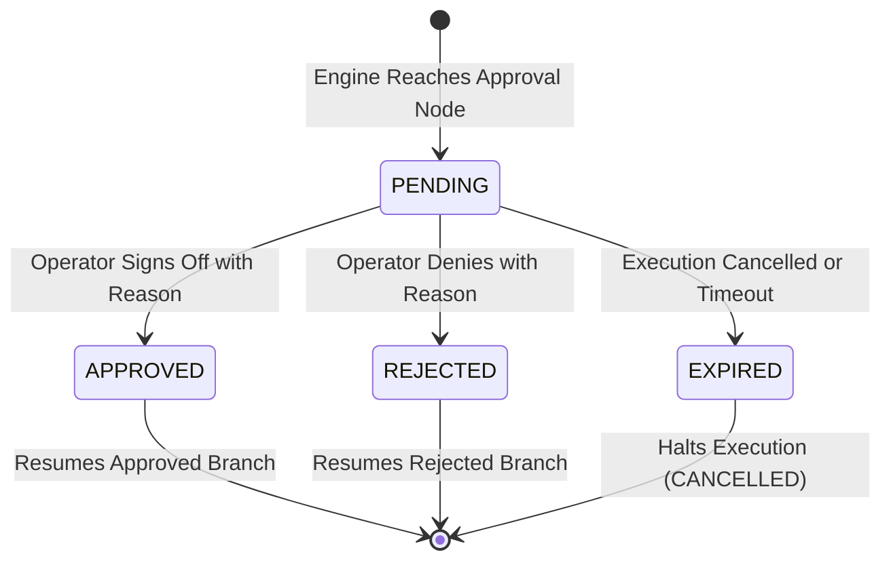

# SOAR Approval Center & RBAC Permission Model

**Document ID:** SEC-AUTH-001  
**Version:** 3.0.0  
**Phase:** 6 — Enterprise Security Orchestration, Automation, and Response  
**Security Classification:** Enterprise SOC Internal  
**Design Identity:** Obsidian Sentinel

---

## 1. Overview

Autonomous response systems operating without human oversight risk service disruption or excessive remediation. The AutoHeal SOAR platform implements a strict **Human-in-the-Loop (HITL) Approval Center** paired with Role-Based Access Control (RBAC). Privileged and high-impact actions pause execution, notify operators, and require authenticated cryptographic sign-off before proceeding.

---

## 2. Role-Based Access Control (RBAC) Matrix

| Operation | `soc:viewer` | `soc:analyst` | `soc:lead` | `soc:admin` |
| :--- | :---: | :---: | :---: | :---: |
| View Playbooks & Node Catalog | Yes | Yes | Yes | Yes |
| View Executions & Telemetry Traces | Yes | Yes | Yes | Yes |
| Run Playbook in **DRY_RUN** Mode | No | Yes | Yes | Yes |
| Create / Edit Playbook Drafts | No | Yes | Yes | Yes |
| Trigger **LIVE** Execution (Standard) | No | Yes | Yes | Yes |
| Approve Standard Analyst Gates | No | Yes | Yes | Yes |
| Approve High-Impact Actions | No | No | Yes | Yes |
| Approve System Admin Gates | No | No | No | Yes |
| Publish Playbook Versions | No | No | Yes | Yes |
| Cancel In-Flight Executions | No | Yes | Yes | Yes |
| View Full Security Audit Logs | No | Yes | Yes | Yes |

---

## 3. Approval Request Lifecycle



### 3.1 State Definitions
- **`PENDING`:** Execution paused at approval node. Single-use token generated and awaiting human interaction.
- **`APPROVED`:** Authorized operator approved the request. Mandatory justification logged in audit log. Traversal resumes downstream on `approved` handle.
- **`REJECTED`:** Operator rejected the request. Mandatory justification documented. Traversal resumes downstream on `rejected` handle (e.g. logging an audit note or alerting).
- **`EXPIRED`:** Execution was cancelled by an operator or timed out. Associated pending approval tokens are invalidated.

---

## 4. Cryptographic Single-Use Tokens & Replay Defense

Every approval gate generates a unique, cryptographically random identifier:
```python
approval_id = f"APPR-{datetime.now(timezone.utc).strftime('%Y%m%d')}-{secrets.token_hex(4).upper()}"
```

### Replay Attack Prevention
When an operator submits a decision via `POST /api/soar/approvals/{approval_id}/decide`:
1. The database checks current status:
   ```sql
   SELECT status, playbook_id, execution_id FROM soar_approvals WHERE approval_id = ?
   ```
2. If `status != 'PENDING'`, the request is immediately rejected with HTTP 400:
   ```
   ValueError: Approval APPR-20261101-ABCD already decided as 'APPROVED'. Replay rejected.
   ```
3. Decisions are atomic: the record is updated in a single transaction, preventing race conditions or duplicate execution of privileged actions.

---

## 5. Mandatory Decision Justification

To maintain regulatory compliance and forensics integrity, decision justifications cannot be omitted:
- **Approval:** Requires a statement of business authorization (e.g. *"Authorized emergency containment for SQL injection attack from compromised shopping partner."*).
- **Rejection:** Requires a statement of determination (e.g. *"False positive: activity determined to be scheduled authorized penetration testing."*).

All decisions are recorded immutably in `soar_audit_logs` with timestamps, actor emails, client IPs, and full justification text.
