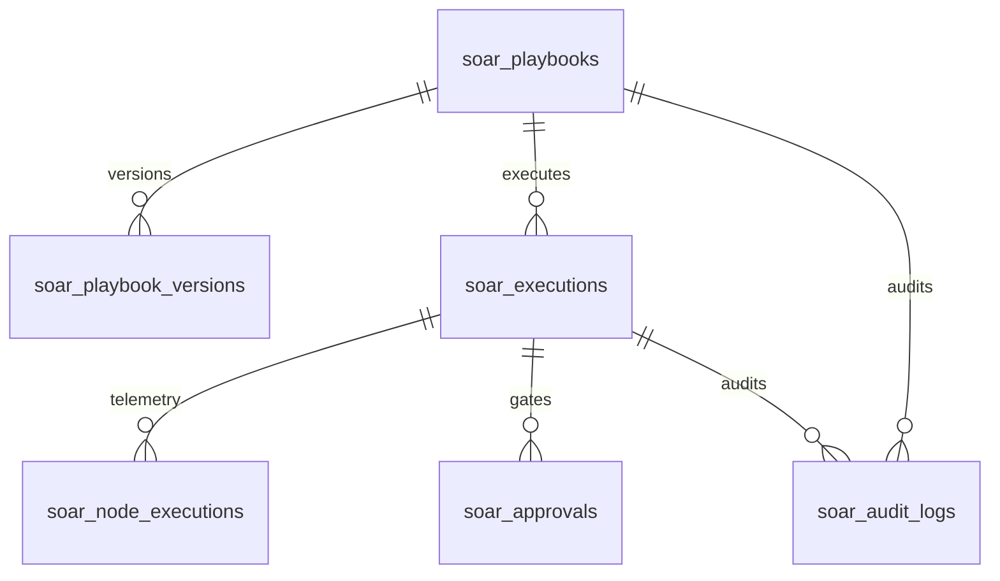

# Phase 6 Database Schema & Migration Specification

**Document ID:** DB-SCHEMA-006  
**Version:** 3.0.0  
**Phase:** 6 — Enterprise Security Orchestration, Automation, and Response  
**Security Classification:** Enterprise SOC Internal  
**Target Database:** SQLite (`autoheal/data/shopsphere.db`)

---

## 1. Overview

Phase 6 introduces enterprise persistence for playbooks, versioned workflow graphs, execution traces, human approvals, and security audit trails. All changes are backward compatible with previous Phases 0–5 and are automatically initialized by `init_db()` in `autoheal/shopsphere/database.py`.

---

## 2. Table Definitions (Tables 16–21)



### Table 16: `soar_playbooks`
Core registry of automated response playbooks.
```sql
CREATE TABLE IF NOT EXISTS soar_playbooks (
    id INTEGER PRIMARY KEY AUTOINCREMENT,
    playbook_id TEXT UNIQUE NOT NULL,
    name TEXT NOT NULL,
    description TEXT,
    category TEXT NOT NULL,
    status TEXT NOT NULL DEFAULT 'DRAFT',
    current_version INTEGER NOT NULL DEFAULT 1,
    trigger_type TEXT NOT NULL DEFAULT 'NEW_INCIDENT',
    trigger_config_json TEXT,
    owner TEXT NOT NULL DEFAULT 'admin@sentinel.sec',
    required_permissions TEXT DEFAULT '["soc:analyst"]',
    created_at TIMESTAMP DEFAULT CURRENT_TIMESTAMP,
    updated_at TIMESTAMP DEFAULT CURRENT_TIMESTAMP
);
```

### Table 17: `soar_playbook_versions`
Immutable versioned snapshots of workflow graph canvas definitions.
```sql
CREATE TABLE IF NOT EXISTS soar_playbook_versions (
    id INTEGER PRIMARY KEY AUTOINCREMENT,
    playbook_id TEXT NOT NULL,
    version INTEGER NOT NULL,
    nodes_json TEXT NOT NULL,
    edges_json TEXT NOT NULL,
    viewport_json TEXT DEFAULT '{"x":0,"y":0,"zoom":1}',
    is_published INTEGER NOT NULL DEFAULT 0,
    change_summary TEXT,
    created_by TEXT NOT NULL,
    created_at TIMESTAMP DEFAULT CURRENT_TIMESTAMP,
    UNIQUE(playbook_id, version)
);
```

### Table 18: `soar_executions`
Top-level execution sessions of automated playbooks.
```sql
CREATE TABLE IF NOT EXISTS soar_executions (
    id INTEGER PRIMARY KEY AUTOINCREMENT,
    execution_id TEXT UNIQUE NOT NULL,
    playbook_id TEXT NOT NULL,
    playbook_version INTEGER NOT NULL,
    playbook_name TEXT NOT NULL,
    trigger_source TEXT NOT NULL,
    incident_id TEXT,
    event_id TEXT,
    simulation_id TEXT,
    execution_mode TEXT NOT NULL DEFAULT 'LIVE',
    status TEXT NOT NULL DEFAULT 'QUEUED',
    current_node_id TEXT,
    context_json TEXT,
    verification_status TEXT DEFAULT 'PENDING',
    duration_ms REAL DEFAULT 0.0,
    error_message TEXT,
    triggered_by TEXT NOT NULL,
    started_at TIMESTAMP DEFAULT CURRENT_TIMESTAMP,
    completed_at TIMESTAMP
);
```

### Table 19: `soar_node_executions`
Granular per-node execution traces and telemetry.
```sql
CREATE TABLE IF NOT EXISTS soar_node_executions (
    id INTEGER PRIMARY KEY AUTOINCREMENT,
    execution_id TEXT NOT NULL,
    node_id TEXT NOT NULL,
    node_type TEXT NOT NULL,
    node_name TEXT NOT NULL,
    status TEXT NOT NULL,
    input_json TEXT,
    output_json TEXT,
    duration_ms REAL DEFAULT 0.0,
    error_message TEXT,
    retry_count INTEGER DEFAULT 0,
    completed_at TIMESTAMP DEFAULT CURRENT_TIMESTAMP
);
```

### Table 20: `soar_approvals`
Human-in-the-loop authorization gates and single-use decision tokens.
```sql
CREATE TABLE IF NOT EXISTS soar_approvals (
    id INTEGER PRIMARY KEY AUTOINCREMENT,
    approval_id TEXT UNIQUE NOT NULL,
    execution_id TEXT NOT NULL,
    node_id TEXT NOT NULL,
    playbook_id TEXT NOT NULL,
    action_type TEXT NOT NULL,
    action_target TEXT NOT NULL,
    action_description TEXT NOT NULL,
    incident_id TEXT,
    status TEXT NOT NULL DEFAULT 'PENDING',
    decided_by TEXT,
    reason TEXT,
    requested_at TIMESTAMP DEFAULT CURRENT_TIMESTAMP,
    decided_at TIMESTAMP
);
```

### Table 21: `soar_audit_logs`
Immutable security and administrative audit trail.
```sql
CREATE TABLE IF NOT EXISTS soar_audit_logs (
    id INTEGER PRIMARY KEY AUTOINCREMENT,
    log_id TEXT UNIQUE NOT NULL,
    action_type TEXT NOT NULL,
    playbook_id TEXT,
    execution_id TEXT,
    actor TEXT NOT NULL,
    details_json TEXT,
    ip_address TEXT DEFAULT '127.0.0.1',
    created_at TIMESTAMP DEFAULT CURRENT_TIMESTAMP
);
```

---

## 3. High-Performance Index Specifications

To guarantee sub-millisecond lookups on active workflows and high-concurrency dashboards, 11 dedicated indexes were established:

| Index Name | Target Table | Target Columns | Purpose |
| :--- | :--- | :--- | :--- |
| `idx_soar_playbooks_status` | `soar_playbooks` | `(status)` | Fast filtering of published vs draft playbooks. |
| `idx_soar_playbooks_cat` | `soar_playbooks` | `(category)` | Instant category-based playbook selection. |
| `idx_soar_versions_lookup` | `soar_playbook_versions`| `(playbook_id, version)` | Exact version graph retrieval. |
| `idx_soar_exec_playbook` | `soar_executions` | `(playbook_id)` | Playbook historical metrics and execution counts. |
| `idx_soar_exec_status` | `soar_executions` | `(status)` | Active running/waiting execution queries. |
| `idx_soar_exec_incident` | `soar_executions` | `(incident_id)` | Incident Command Center playbook linkage. |
| `idx_soar_node_exec_id` | `soar_node_executions`| `(execution_id)` | Trace viewer timeline and node tree rendering. |
| `idx_soar_approvals_status` | `soar_approvals` | `(status)` | Pending approval queue monitoring (< 1ms). |
| `idx_soar_approvals_exec` | `soar_approvals` | `(execution_id)` | Resumption lookup by execution token. |
| `idx_soar_audit_playbook` | `soar_audit_logs` | `(playbook_id)` | Playbook-specific change and execution audit. |
| `idx_soar_audit_action` | `soar_audit_logs` | `(action_type)` | Forensic compliance log filtering. |

---

## 4. Backward Compatibility

- Existing tables (`products`, `orders`, `users`, `security_events`, `security_incidents`, `blocked_clients`, etc.) are completely unmodified.
- Relations to `security_incidents` (`incident_id`) are non-enforcing loose foreign keys to allow standalone testing and simulated replay execution without incident dependencies.
