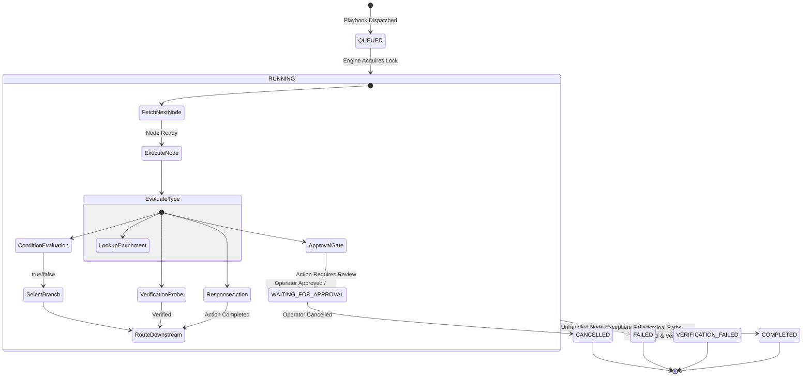

# SOAR Execution Engine Documentation

**Document ID:** ENG-SOAR-001  
**Version:** 3.0.0  
**Phase:** 6 — Enterprise Security Orchestration, Automation, and Response  
**Security Classification:** Enterprise SOC Internal  
**Design Identity:** Obsidian Sentinel

---

## 1. Overview

The `SOARExecutionEngine` is the orchestration core of the AutoHeal SOAR platform. It converts declarative DAG workflow models into coordinated, real-time security actions executed against the ShopSphere application environment, with support for live execution, dry-run simulation, approval pauses, and closed-loop verification.

---

## 2. Execution Modes

The engine operates under two distinct modes:

| Mode | Mutates System State | Target Enforcement | Telemetry & Traces | Use Case |
| :--- | :--- | :--- | :--- | :--- |
| **LIVE** | **Yes** | Inserts IP blocks into WAF, revokes customer sessions, locks accounts, appends incident notes. | Full per-node latency, input, and output traces saved in `soar_node_executions`. | Real incident containment and verified automated response. |
| **DRY_RUN** | **No** | Simulates action outcomes (`{"simulated": true}`). Bypasses actual DB updates and WAF blocks. | Identical trace logging with `simulated: true` markers. | Safe testing of new playbooks and rule validation before production deployment. |

---

## 3. Workflow Traversal Lifecycle



---

## 4. Per-Node Execution Pipeline

Each node in the topological traversal passes through a standardized execution pipeline:

1. **Pre-Execution Context Gathering:** Resolves parameterized values (e.g. `context["source_ip"]`, `context["incident_id"]`) from the active execution context.
2. **Telemetry Timestamp:** Records high-precision timer `time.perf_counter()`.
3. **Execution Routing:** Invokes the specialized category handler inside `execute_playbook()`.
4. **Outcome Recording:** Logs output payload, status (`COMPLETED`, `FAILED`, `WAITING_FOR_APPROVAL`), and latency into `soar_node_executions`.
5. **State Progression:** Updates execution-level variables (`last_condition`, `last_action_status`) and appends downstream nodes to the traversal queue.

---

## 5. Approval Gate Pause & Resume Protocol

When a node of category `Approval` is encountered during live execution:

1. **State Snapshot:** The current execution context is serialized into `soar_executions.context_json`.
2. **Approval Record:** A cryptographic single-use approval request is created in `soar_approvals`:
   ```sql
   INSERT INTO soar_approvals (approval_id, execution_id, node_id, playbook_id, action_type, action_target, status)
   VALUES ('APPR-20261101-ABCD', 'EXEC-...', 'node_approval_account', 'PB-...', 'HIGH_IMPACT_ACTION', '198.51.100.77', 'PENDING');
   ```
3. **Execution State Transition:** `soar_executions.status` transitions to `WAITING_FOR_APPROVAL`.
4. **Execution Suspension:** The engine halts the traversal loop and returns the execution dossier to the API.
5. **Operator Decision & Resumption:**
   - An authorized operator submits an approval or rejection via `POST /api/soar/approvals/{id}/decide`.
   - The engine is reinvoked with `resume_from_approval_id=approval_id`.
   - The engine restores context, fetches the decision, records it in `context["execution_vars"]["last_approval_decision"]`, and resumes graph traversal directly through the downstream `approved` or `rejected` branch handle.

---

## 6. Verification Handoff

The final stage of response playbooks routes into verification nodes:
- `verify_ip_blocked`: Probes `is_client_blocked(ip)`.
- `verify_session_revoked`: Queries `users` table to ensure target session token is null.
- `verify_benign_traffic`: Simulates legitimate shopper traffic hitting `/api/shop/products` to ensure no false-positive collateral disruption.
- `verify_remediation_outcome`: Calls `AppSecVerifier.verify_incident_containment(incident_id)` for dual-probe confirmation.

If verification fails, `soar_executions.verification_status` is marked `VERIFICATION_FAILED` and the execution status transitions to `VERIFICATION_FAILED`, triggering SOC alerting.

---

## 7. Performance & Concurrency

- **Average Node Execution Time:** < 5 ms for in-memory logic, lookup, and WAF rule updates.
- **Verification Probe Latency:** 10–25 ms for full HTTP loopback simulation.
- **Isolated State:** Each execution uses a unique `execution_id` and isolated context dictionary, allowing concurrent multi-tenant execution across distinct incidents without cross-talk.
