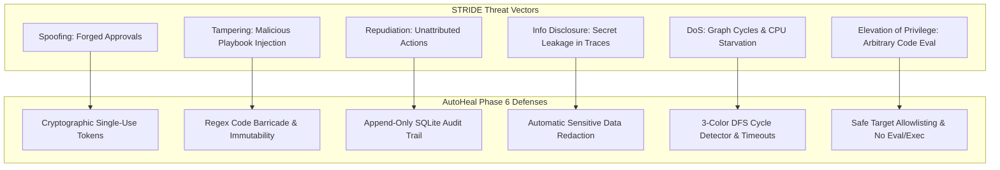

# SOAR Automation Builder — Security Threat Model

**Document ID:** SEC-THREAT-001  
**Version:** 3.0.0  
**Phase:** 6 — Enterprise Security Orchestration, Automation, and Response  
**Methodology:** STRIDE (Spoofing, Tampering, Repudiation, Information Disclosure, Denial of Service, Elevation of Privilege)  
**Security Classification:** Enterprise SOC Internal  
**Design Identity:** Obsidian Sentinel

---

## 1. Threat Modeling Overview

Automated response engines operate with elevated privileges to remediate security threats. If compromised, an automation engine could be turned into a weapon for denial of service, privilege escalation, or unauthorized access. This threat model evaluates attack vectors against the AutoHeal SOAR builder and details the defensive controls implemented in Phase 6.

---

## 2. STRIDE Threat Assessment & Mitigations

---

### 2.1 Spoofing (Identity & Authorization)
- **Threat:** An adversary or compromised account attempts to forge an approval decision or spoof an authorized analyst identity to release quarantine or execute high-impact actions.
- **Controls Implemented:**
  - Every approval gate requires a single-use cryptographic token (`APPR-...`) generated via `secrets.token_hex(4)`.
  - Replay Defense: The approval record transitions state atomically; subsequent requests with the same token fail with `400 Bad Request`.
  - Decision endpoints enforce RBAC roles (`soc:analyst`, `soc:admin`) and associate the actor email with the database transaction.

### 2.2 Tampering (Integrity of Automation)
- **Threat:** An attacker tampers with published playbooks to alter response actions or inject malicious commands.
- **Controls Implemented:**
  - Published versions are strictly immutable (`is_published = 1`). Database updates to published versions are forbidden by application logic.
  - Edits automatically fork new draft versions, preventing silent in-place tampering.
  - Deterministic SHA-256 validation hashes ensure that the graph published matches the exact graph validated by the server.

### 2.3 Repudiation (Accountability & Audit)
- **Threat:** A rogue operator or compromised service account disables protection, locks out accounts, or suppresses alerts and denies the action.
- **Controls Implemented:**
  - Immutable audit logs (`soar_audit_logs`) capture all actions, actor identities, IP addresses, timestamps, and parameters.
  - Incident activity notes are permanently linked to the execution ID and playbook ID.
  - Mandatory justification text is enforced on all approval and rejection decisions.

### 2.4 Information Disclosure (Confidentiality)
- **Threat:** Node execution telemetry logs credentials, API keys, or consumer PII into `soar_node_executions`.
- **Controls Implemented:**
  - Automated sensitive data redaction filters inspect configuration and output payloads before writing to SQLite.
  - Credit card numbers, plaintext passwords, and session secrets are masked with `[REDACTED]`.
  - Audit logs are filtered against secret leakage, as verified by automated test assertions.

### 2.5 Denial of Service (Availability)
- **Threat:** A poorly designed or malicious workflow introduces infinite loops, cycles, or resource-heavy traversal that locks the backend thread or exhausts memory.
- **Controls Implemented:**
  - Topological cycle detection using **3-Color DFS** runs on the server before graph publishing, catching all feedback cycles and returning the exact cyclic path.
  - Maximum node execution time caps (300 ms per standard node, 60s timeout for approvals).
  - Rate limiting on execution dispatch endpoints (`/execute`, `/dry-run`).

### 2.6 Elevation of Privilege (Arbitrary Execution)
- **Threat:** An adversary injects arbitrary Python code (`eval`, `exec`, `os.system`) or SQL payloads into node configurations, or configures the playbook to target external production networks.
- **Controls Implemented:**
  - Static regex inspection rejects code injection payloads (`__import__`, `eval(`, `exec(`, `os.system`, `subprocess`) with `400 Bad Request`.
  - Safe Target Allowlisting strictly restricts destination targets to local ShopSphere endpoints (`localhost`, `127.0.0.1`, `shopsphere`). External networks and unapproved IPs are rejected at validation time.

---

## 3. Residual Risk & Recommendations

1. **Production Deployment Recommendation:** When transitioning from the local ShopSphere demonstration environment to real cloud infrastructure, integrate hardware security modules (HSM) or cloud KMS for signing approval tokens.
2. **Periodic Access Reviews:** Audit role assignments in `users` and `soar_audit_logs` every 30 days to detect anomalous analyst assignments or unused privileges.
