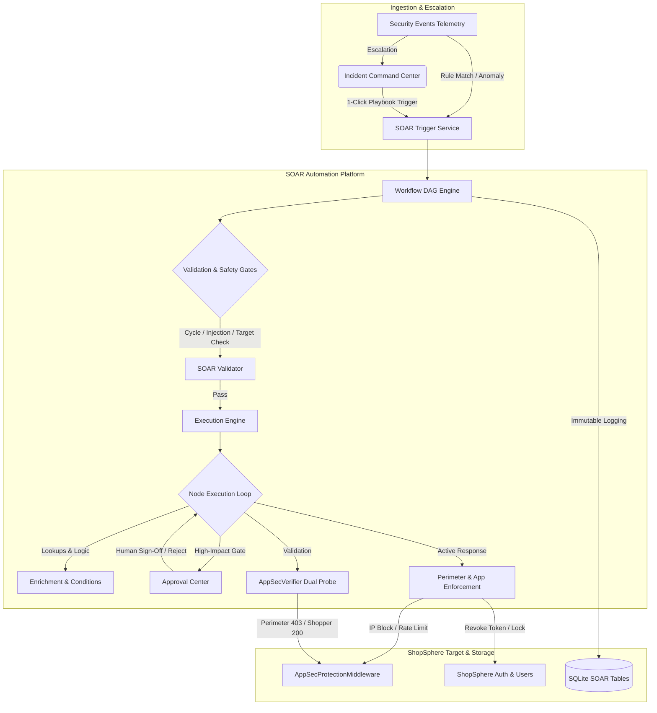
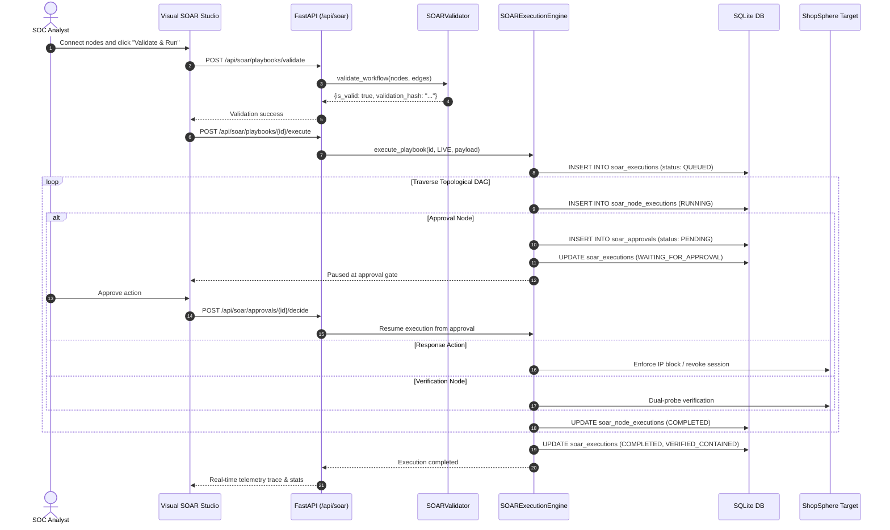

# Visual SOAR Automation Builder — System Architecture

**Document ID:** ARCH-SOAR-001  
**Version:** 3.0.0  
**Phase:** 6 — Enterprise Security Orchestration, Automation, and Response  
**Security Classification:** Highly Confidential / Enterprise SOC Internal  
**Design Identity:** Obsidian Sentinel (`#090D14`, `#101722`, `#151F2C`, `#253344`, `#F1F5F9`, `#94A3B8`, `#22C55E`, `#38BDF8`, `#F59E0B`, `#EF4444`, `#A78BFA`)

---

## 1. Executive Summary

Phase 6 implements the **Visual SOAR Automation Builder** within the AutoHeal autonomous Security Operations Center (SOC) platform. The system bridges detection, investigation, and closed-loop remediation through a directed acyclic graph (DAG) workflow engine. Security analysts can visually author, test in dry-run mode, and execute multi-stage playbooks against the ShopSphere e-commerce target application with mathematical verification and human-in-the-loop approval gates.

---

## 2. Architectural Pillars

### 2.1 Backend-Authoritative Execution
All DAG parsing, topological validation, cycle detection, and node executions run on the server. The client UI is purely a presentation layer that submits canonical graph definitions (`nodes` and `edges`) and displays telemetry traces.

### 2.2 Closed-Loop Dual-Probe Verification
Remediations are not assumed successful upon execution. Every active action connects to a verification stage executing automated dual-probe verification via `AppSecVerifier`:
1. **Adversary Probe:** Confirms malicious traffic receives HTTP 403 Forbidden.
2. **Benign Shopper Probe:** Confirms legitimate shopping traffic retains HTTP 200 OK and normal latency.

### 2.3 Strict Target Allowlisting
Automated playbooks are restricted exclusively to the authorized local ShopSphere environment (`localhost`, `127.0.0.1`, `shopsphere`). External networks, production infrastructure, or unauthorized IPs are rejected by `SOARValidator` before execution.

### 2.4 Human-in-the-Loop Approval Gates
High-impact operations (account lockouts, broad rate-limiting, external notifications) pause execution, generate single-use cryptographic approval requests, and notify the SOC approval queue. Traversal resumes only when an authorized operator submits an approval or rejection decision.

---

## 3. Subsystem Breakdown

| Subsystem | Primary Python / JS File | Responsibility |
| :--- | :--- | :--- |
| **Data Schema & Models** | `autoheal/shopsphere/database.py` `src/appsec/soar_models.py` | 6 relational tables (`soar_playbooks`, `soar_playbook_versions`, `soar_executions`, `soar_node_executions`, `soar_approvals`, `soar_audit_logs`) and indexed query engine. |
| **Workflow Engine** | `src/appsec/soar_engine.py` | Topological sorting, 3-color DFS cycle detector, condition evaluator, step-by-step orchestrator, dry-run simulator. |
| **REST API Router** | `src/appsec/soar_api.py` | 20 endpoints mounted under `/api/soar` handling CRUD, drafting, validation, execution, approvals, and audits. |
| **Visual Canvas UI** | `web/templates/index.html` `web/static/js/script.js` | SVG connection wire renderer, node drag-and-drop, zoom/pan transforms, node configuration drawer, approval center, execution monitor. |
| **Incident Command Handoff** | `web/static/js/script.js` | Tab 6 response actions integration providing recommended playbooks and 1-click dry-run/live execution. |

---

## 4. End-to-End Data Flow

---

## 5. Security & Isolation Boundaries

1. **Memory Separation:** Workflows execute inside an isolated execution context dictionary (`context = {"incident": ..., "source_ip": ..., "execution_vars": ...}`). Variables from one execution cannot leak into another.
2. **Code Execution Barricade:** Node configurations are treated strictly as declarative JSON schemas. Python `eval()`, `exec()`, arbitrary module imports, and shell invocations are statically scanned and rejected with HTTP 400.
3. **Audit Trail Immutability:** Every draft save, version publish, workflow validation, live execution, approval grant, and execution cancellation creates an append-only audit record in `soar_audit_logs`.
