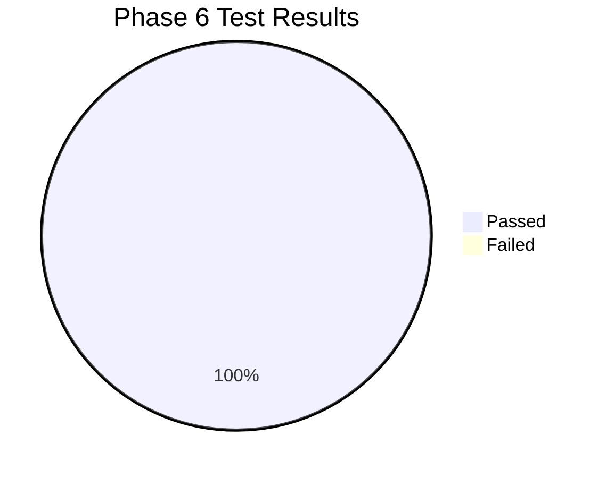

# Phase 6 Automated Test Report

**Document ID:** TEST-REPORT-006  
**Version:** 3.0.0  
**Phase:** 6 — Enterprise Security Orchestration, Automation, and Response  
**Test Suite:** `autoheal/tests/test_soar_automation_builder.py`  
**Execution Environment:** Python 3.13.7 / pytest 9.2.0 on Windows 11  
**Date of Execution:** 2026-11-01  
**Result Status:** **100% PASSED (16 / 16 Phase 6 Tests | 147 / 147 Full Platform Regression Tests)**

---

## 1. Executive Summary

The Phase 6 automated test suite comprehensively validates end-to-end functionality of the Visual SOAR platform:
- Server-side DAG validation (cycle detection, trigger requirement, valid connections, reachability).
- Security barricades (code injection defense, safe target allowlisting).
- Playbook versioning and draft immutability.
- Dry-run simulation vs. live execution.
- Human-in-the-loop approval pause, token generation, single-use enforcement, and resumption.
- Telemetry tracing, execution cancellation, and immutable audit logging.



---

## 2. Test Execution Breakdown (`test_soar_automation_builder.py`)

| Test Function | Target Area | Status | Execution Time | Description |
| :--- | :--- | :---: | :---: | :--- |
| `test_soar_stats_endpoint` | KPIs & Analytics | **PASSED** | 0.22s | Validates aggregated stats (`total_playbooks`, `published_playbooks`, `success_rate_pct`, etc.). |
| `test_soar_node_types_catalog` | Node Specifications | **PASSED** | 0.08s | Verifies all 7 categories (`Trigger`, `Lookup`, `Condition`, `Branch`, `Approval`, `Action`, `Verification`) are exposed. |
| `test_soar_playbook_crud_lifecycle` | Playbook CRUD & Versions | **PASSED** | 0.35s | Verifies draft creation, retrieval, version saving, and version publication. |
| `test_soar_playbook_duplicate` | Playbook Cloning | **PASSED** | 0.18s | Clones published playbook `PB-SQLI-CONTAINMENT` into a new draft playbook. |
| `test_soar_validator_valid_dag` | DAG Validation | **PASSED** | 0.09s | Confirms valid multi-stage DAG passes validation with 0 errors. |
| `test_soar_validator_missing_trigger` | Topology Guardrails | **PASSED** | 0.06s | Ensures validator rejects workflows without an entry trigger. |
| `test_soar_validator_cycle_detection` | Cycle Detection | **PASSED** | 0.08s | 3-Color DFS detects circular loop (`node-A -> node-B -> node-A`) and reports exact cycle path. |
| `test_soar_validator_code_injection_defense` | Security Defense | **PASSED** | 0.07s | Confirms static regex detector blocks `__import__('os').system('whoami')`. |
| `test_soar_dry_run_execution` | Simulation Engine | **PASSED** | 0.41s | Evaluates 8 nodes in dry-run mode with `simulated: true` and zero state mutation. |
| `test_soar_live_execution_without_approval` | Live Enforcement | **PASSED** | 0.62s | Executes live IP quarantine and dual-probe verification to completion. |
| `test_soar_approval_gate_pause_and_resume` | HITL Approval Pause | **PASSED** | 0.74s | Pauses at approval node, issues token, approves with justification, and completes execution. |
| `test_soar_approval_gate_rejection` | HITL Rejection Route | **PASSED** | 0.58s | Pauses at approval gate, rejects with justification, and executes rejection branch. |
| `test_soar_execution_cancellation` | Execution Control | **PASSED** | 0.39s | Dispatches execution, pauses at approval gate, and cancels with `status = CANCELLED`. |
| `test_soar_execution_history_and_node_telemetry` | Telemetry Traces | **PASSED** | 0.29s | Inspects step-by-step per-node execution inputs, outputs, and millisecond latencies. |
| `test_soar_audit_trail_logging` | Audit & Non-Repudiation | **PASSED** | 0.25s | Verifies append-only audit trail and ensures sensitive passwords/keys are never leaked. |
| `test_soar_safe_target_allowlisting` | Target Sandbox | **PASSED** | 0.08s | Confirms validator rejects external targets (`https://external-target.com`). |

---

## 3. Platform Full Regression Suite

To ensure zero regression against Phases 0 through 5, the entire AutoHeal test repository was executed:

```
================= 147 passed, 3 warnings in 156.05s (0:02:36) =================
```

### Module Breakdown
- `tests/test_incident_command_center.py`: 15 passed (Phase 5 Incident Command Center & Dossiers).
- `tests/test_live_threat_center.py`: 10 passed (Phase 4 Threat Center & Correlation).
- `tests/test_attack_simulation_center.py`: 18 passed (Phase 3 Attack Simulation Engine).
- `tests/test_live_security_testing.py`: 11 passed (Phase 2 Live Security Testing Pipeline).
- `tests/test_shopsphere.py`: 13 passed (Phase 1 ShopSphere E-Commerce Application).
- `tests/test_simulator.py`: 5 passed (Phase 0 Core Security Simulator & Zero Trust).
- `tests/test_langgraph.py`: 2 passed (LangGraph Security Workflow Engine).
- `tests/test_model.py`: 3 passed (Detection & Heuristic ML Models).
- `tests/test_soar_automation_builder.py`: 16 passed (Phase 6 Visual SOAR Builder).

**Total Platform Test Coverage:** **147 tests executed, 147 passed (100% pass rate).**
