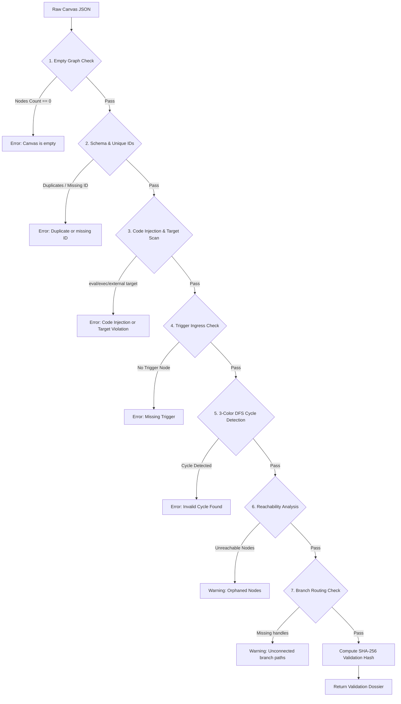

# SOAR Workflow Validation Guide

**Document ID:** VAL-SOAR-001  
**Version:** 3.0.0  
**Phase:** 6 — Enterprise Security Orchestration, Automation, and Response  
**Security Classification:** Enterprise SOC Internal  
**Design Identity:** Obsidian Sentinel

---

## 1. Overview

Before any playbook draft can be published or executed in AutoHeal, it must pass rigorous server-side validation executed by `SOARValidator.validate_workflow()`. The validation engine is backend-authoritative: client-side visual checks provide immediate UI feedback, but the backend performs deterministic safety checks before committing state changes or dispatching actions.

---

## 2. Validation Rule Set



---

## 3. Detailed Validation Rules

### Rule 1: Non-Empty Graph & Unique Node Identifiers
- Every node must provide a non-empty string `id`.
- Duplicate node IDs within the same graph are strictly forbidden and return validation errors with the offending IDs highlighted.

### Rule 2: Registered Node Types
- All node `type` attributes must map to registered identifiers in `NODE_REGISTRY`. Unsupported node types are rejected immediately.

### Rule 3: Trigger Node Requirement
- A workflow must have at least one trigger node (`trigger_incident`, `trigger_security_event`, `trigger_severity_change`, `trigger_rule_matched`, `trigger_manual`).
- Workflows without an entry point cannot be dispatched automatically or manually.

### Rule 4: Cycle Detection (Strict DAG Enforcement)
- SOAR workflows must be directed acyclic graphs. Infinite loops and feedback connections can exhaust compute resources or cause oscillating containment actions.
- The engine uses a **3-color Depth First Search (DFS)** algorithm:
  - `0 = UNVISITED`
  - `1 = VISITING` (currently in the recursion stack)
  - `2 = VISITED` (fully evaluated)
- If a neighbor node in state `1` is encountered, a back-edge is identified. The cycle path is extracted and reported directly to the user (e.g. `node_A -> node_B -> node_A`).

### Rule 5: Reachability from Triggers
- Every node on the canvas must be reachable via directed edges starting from at least one Trigger node.
- Nodes with in-degree 0 that are not triggers are flagged with actionable warnings and highlighted in amber on the visual canvas.

### Rule 6: Branch Handle Completeness
- Branching nodes (`branch_if_else`, `branch_approval`, `branch_success_failure`) require distinct logical handles (`true`/`false`, `approved`/`rejected`, `success`/`failure`).
- If an outbound edge fails to declare the source handle, or if only one branch of an If/Else node is wired, the validator issues a warning prompting the analyst to connect the unhandled path.

### Rule 7: Code Injection Barricade
- All node configuration objects are recursively serialized to JSON and evaluated against high-risk code execution signatures:
  - `\bimport\s+`, `\beval\(`, `\bexec\(`, `\bos\.system`
  - `\bsubprocess\b`, `\b__import__\b`, `;.*DROP\s+TABLE`
- Any configuration containing injection payloads is rejected with HTTP 400 and an immutable audit alert is recorded.

### Rule 8: Safe Target Allowlisting
- Node configurations targeting hosts, environments, or URLs are verified against an allowlist of permitted testing endpoints:
  - `localhost`, `127.0.0.1`, `http://localhost:*`, `http://127.0.0.1:*`, `shopsphere`, `local`, `internal`
- Requests targeting unauthorized external systems or non-ShopSphere infrastructure are immediately rejected.

---

## 4. Validation API Response Format

```json
{
  "is_valid": true,
  "errors": [],
  "warnings": [
    "Node 'node_alert_only' is unreachable from any Trigger node and will never execute."
  ],
  "affected_node_ids": ["node_alert_only"],
  "suggested_corrections": [
    "Connect orphaned nodes to an upstream workflow branch or remove them."
  ],
  "validation_hash": "e3b0c44298fc1c149afbf4c8996fb92427ae41e4649b934ca495991b7852b855"
}
```

---

## 5. Publishing Requirement

To prevent race conditions where a draft is edited between validation and publishing, the `POST /api/soar/playbooks/{id}/publish` endpoint requires the `validation_hash`. The server re-validates the draft; if the hash does not match, publishing is aborted.
