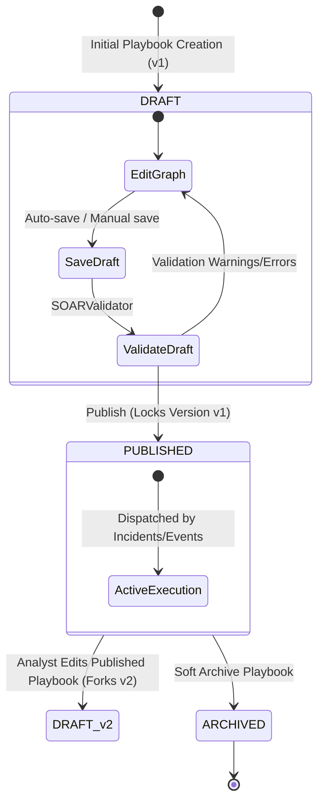

# SOAR Workflow Versioning & Lifecycle Model

**Document ID:** VER-SOAR-001  
**Version:** 3.0.0  
**Phase:** 6 — Enterprise Security Orchestration, Automation, and Response  
**Security Classification:** Enterprise SOC Internal  
**Design Identity:** Obsidian Sentinel

---

## 1. Overview

Security automations operating in high-stakes environments demand strict change control and historical auditability. AutoHeal enforces an immutable versioning lifecycle for all SOAR workflows. Analysts can freely prototype, drag, drop, and test in DRAFT state, while production executions only dispatch against validated, published versions.

---

## 2. Version Lifecycle States



---

## 3. Core Versioning Rules

### 3.1 Immutability of Published Versions
Once a playbook version is published (`is_published = 1` in `soar_playbook_versions`), its rows are immutable:
- `nodes_json`, `edges_json`, and `viewport_json` can never be updated or overwritten.
- This guarantees that historical execution traces recorded months or years later reference the exact graph definition that was executed at that moment in time.

### 3.2 Automatic Draft Forking
When an analyst opens an existing published playbook in the visual editor and saves changes:
1. The system detects that `current_version` is published.
2. It automatically forks a new version record:
   ```python
   new_version = curr_version + 1
   ```
3. A new row is inserted into `soar_playbook_versions` with `version = new_version`, `is_published = 0`, and the updated graph nodes and edges.
4. The parent `soar_playbooks` record is updated with `current_version = new_version` and `status = 'DRAFT'`.
5. Production automated triggers continue to execute against the previous published version until the new draft is formally validated and published.

### 3.3 Overwriting Active Drafts
If the current version is already in `DRAFT` status (`is_published = 0`), subsequent saves simply update that draft version row in-place without incrementing the version number.

### 3.4 Playbook Duplication
Analysts can clone any existing playbook (draft or published) into a standalone new playbook:
- Calling `POST /api/soar/playbooks/{id}/duplicate` clones metadata, nodes, and edges into a new record with a unique ID (e.g. `PB-INJE-3A8F`).
- The new playbook begins at version 1 in `DRAFT` status, allowing rapid templating without impacting the original workflow.

### 3.5 Safe Archival
Playbooks cannot be deleted via API to maintain referential integrity with historical executions and audit logs. Instead, `POST /api/soar/playbooks/{id}/archive` updates `status = 'ARCHIVED'`. Archived playbooks are hidden from active triggers and command center response menus.

---

## 4. Version History Querying

Analysts can inspect all historical revisions of any playbook via:
```http
GET /api/soar/playbooks/{playbook_id}/versions
```
Returning:
```json
[
  {
    "version": 2,
    "is_published": false,
    "change_summary": "Added dual-probe shopper verification stage",
    "created_by": "alex.rivera@sentinel.sec",
    "created_at": "2026-11-01T14:30:00Z"
  },
  {
    "version": 1,
    "is_published": true,
    "change_summary": "Initial baseline containment playbook",
    "created_by": "admin@sentinel.sec",
    "created_at": "2026-11-01T10:00:00Z"
  }
]
```
An analyst can inspect the visual graph of any prior version in read-only mode by passing `?version={v}` to the playbook endpoint.
