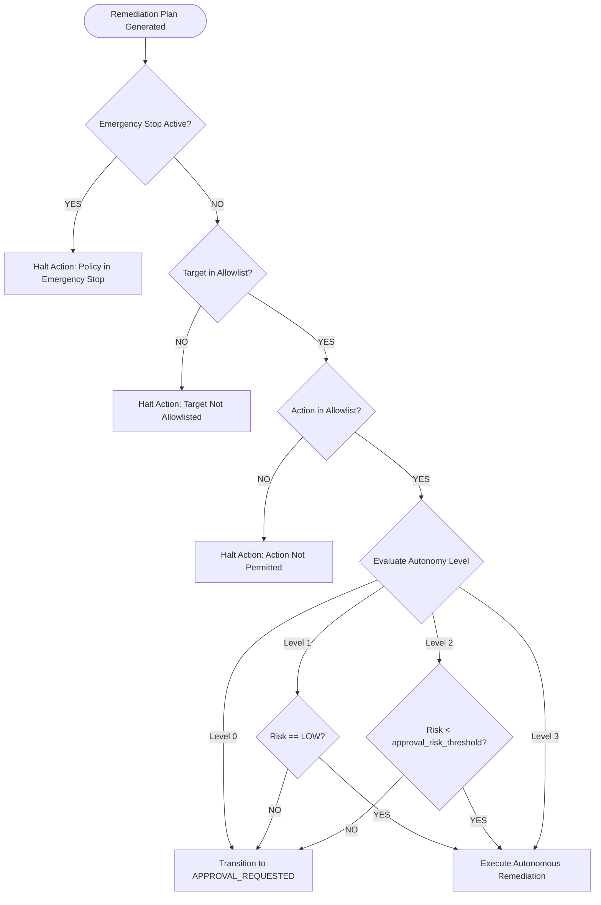

# AutoHeal Phase 7: Autonomy Policy Guide

## 1. Autonomy Philosophy
Autonomous remediation in an enterprise SOC requires guardrails that scale with confidence. AutoHeal enforces a four-tiered autonomy policy model ranging from complete manual oversight to fully autonomous closed-loop execution. Policy rules are governed persistently in the `self_healing_policies` database table and evaluated in real-time before any mutating action is dispatched.

---

## 2. Autonomy Levels Explained

```
   Level 0: Advisory
   [ Detect ] ──> [ Diagnose ] ──> [ Plan ] ──> [ Require Approval ] ──> [ Manual Execution ]

   Level 1: Semi-Autonomous (Low Risk Only)
   [ Detect ] ──> [ Diagnose ] ──> [ Plan ] ──> [ Low Risk? ] ──┬── YES ──> [ Auto-Execute & Verify ]
                                                                └── NO  ──> [ Require Approval ]

   Level 2: Autonomous with High-Risk Approval (Recommended Enterprise Default)
   [ Detect ] ──> [ Diagnose ] ──> [ Plan ] ──> [ Score <= Policy Threshold? ] ──┬── YES ──> [ Auto-Execute & Verify ]
                                                                                 └── NO  ──> [ Require Approval ]

   Level 3: Full Autonomy (All Verified Safe Actions)
   [ Detect ] ──> [ Diagnose ] ──> [ Plan ] ──> [ Allowlisted Target & Action? ] ──> [ Auto-Execute & Continuous Verify ]
```

### Level 0 — Advisory Only (Human-in-the-Loop)
- **Behavior**: AutoHeal continuously ingests telemetry, performs tripartite root-cause analysis, and formulates remediation plans with explainable risk scores.
- **Enforcement**: No mutating remediation action is executed without an explicit, cryptographically traceable human analyst approval.
- **Best For**: Highly regulated environments (PCI-DSS, FedRAMP, HIPAA), initial SOC onboarding, or high-uncertainty maintenance windows.

### Level 1 — Semi-Autonomous (Low Risk Actions Only)
- **Behavior**: Auto-executes remediation plans categorized strictly as `LOW` risk (score $\le 6$). All `MEDIUM`, `HIGH`, and `CRITICAL` plans pause at the `APPROVAL_REQUESTED` stage.
- **Allowed Actions**: IP blocking (`BLOCK_IP`) via WAF/firewall, temporary session locks.
- **Best For**: Preventing high-volume automated reconnaissance and brute force without analyst fatigue.

### Level 2 — Autonomous with Threshold Approval (Enterprise Default)
- **Behavior**: Auto-executes `LOW` and `MEDIUM` risk actions up to the configured `approval_risk_threshold`. Any plan exceeding this threshold (e.g. `HIGH` or `CRITICAL`, such as AST source code patching or global rate limit shifts) halts for analyst review.
- **Allowed Actions**: `BLOCK_IP`, `APPLY_RATE_LIMIT`, `REVOKE_SESSION`. Code patches require review unless pre-approved.
- **Best For**: Modern 24/7 autonomous SOC operations balancing swift incident containment with enterprise change management safety.

### Level 3 — Full Autonomy (Closed-Loop Autonomous Healing)
- **Behavior**: Fully autonomous end-to-end execution across all validated actions on allowlisted targets. Includes automated AST code patching, automatic dual-probe verification, and immediate automated rollback if verification fails.
- **Allowed Actions**: All allowlisted actions (`BLOCK_IP`, `APPLY_RATE_LIMIT`, `CODE_REPAIR_PATCH`, `REVOKE_SESSION`).
- **Safety Rails**: Strictly bounded by Target Allowlisting (`127.0.0.1`, `localhost`, `ShopSphere`), max concurrency limit, and immediate circuit breaker tripping if verification fails.

---

## 3. Policy Configuration Schema

The active policy is stored in `self_healing_policies` with the following configuration attributes:

| Field | Type | Description | Default Value |
| :--- | :--- | :--- | :--- |
| `policy_id` | TEXT | Primary identifier | `POLICY-SENTINEL-DEFAULT` |
| `policy_name` | TEXT | Human-readable name | `Sentinel Enterprise Autonomous Defense` |
| `autonomy_level` | INTEGER | Autonomy level (0–3) | `2` |
| `emergency_stop` | INTEGER | Master circuit breaker (0=active, 1=stopped) | `0` |
| `action_allowlist` | JSON | Permitted remediation action types | `["BLOCK_IP", "APPLY_RATE_LIMIT", "CODE_REPAIR_PATCH", "REVOKE_SESSION"]` |
| `target_allowlist` | JSON | Permitted hostnames, IPs, and services | `["127.0.0.1", "localhost", "ShopSphere", "10.0.0.0/8"]` |
| `max_risk_level` | TEXT | Hard ceiling on allowed risk | `HIGH` |
| `approval_risk_threshold` | TEXT | Threshold triggering human approval | `HIGH` |
| `max_concurrent_executions`| INTEGER | Concurrency limiter | `5` |
| `require_dual_approval` | INTEGER | High-risk dual analyst sign-off | `0` (1 for strict environments) |
| `auto_rollback_on_failure` | INTEGER | Automatic rollback if verification fails | `1` |
| `version` | INTEGER | Incrementing policy version number | `1` |

---

## 4. Policy Enforcement Workflow



All policy changes, modifications, and emergency stop toggles are recorded immutably in `self_healing_audit_logs`.
