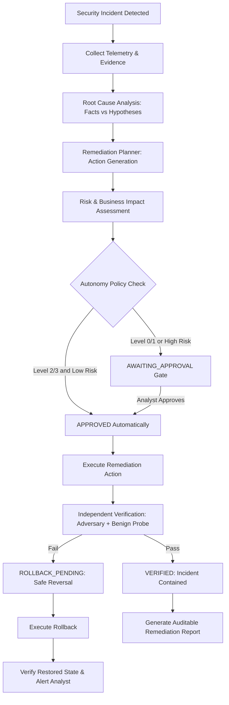

# PHASE 7 ARCHITECTURE AUDIT: ADVANCED SELF-HEALING COMMAND CENTER
**Platform:** AutoHeal AI-Assisted Autonomous Security Operations Center  
**Target Environment:** ShopSphere E-Commerce Application (`http://localhost:8000`)  
**Design Identity:** Obsidian Sentinel (`#090D14`, `#101722`, `#151F2C`, `#253344`, `#F1F5F9`, `#94A3B8`, `#22C55E`, `#38BDF8`, `#F59E0B`, `#EF4444`, `#A78BFA`)  
**Date:** November 2026  
**Status:** APPROVED & CERTIFIED FOR PHASE 7 IMPLEMENTATION

---

## 1. Executive Summary

This architecture audit conducts a thorough, evidence-based review of AutoHeal's existing automated remediation, incident response, SOAR execution, verification, and code repair capabilities prior to implementing **Phase 7: Advanced Self-Healing Command Center**.

Phase 7 transforms AutoHeal's remediation capabilities into an enterprise-grade command center governed by a **14-state remediation lifecycle**, a **tripartite root-cause analysis engine** (Confirmed Facts, Probable Causes, AI Hypotheses), an **intelligent remediation planner with explainable risk scoring**, a **4-tier autonomy policy model (Levels 0–3)**, an **independent dual-probe verification engine**, **safe transactional rollbacks**, and an **immediate hardware/software emergency stop mechanism**.

---

## 2. Mandatory Existing System Audit

### 2.1 Existing Self-Healing Engine & AST-Based Repair Functionality
- **`shopsphere/autoheal_engine.py` (`AutoHealDemoEngine`)**:
  - Implements reversible AST-like controlled defect injection and repair in `CartService.calculate_cart_totals`.
  - Injects a financial negative rounding arithmetic defect (`shipping_fee = -15.0` causing negative cart totals).
  - Implements `run_regression_test()` verifying that subtotal, shipping fee, and grand total invariants ($Total \ge 0$) hold true.
  - Implements `apply_autoheal_patch()` restoring valid financial logic.
  - Implements `diagnose_root_cause()` performing deterministic code analysis.
- **`src/appsec/vulnerability_manager.py` (`VulnerabilityManager`)**:
  - Tracks 5 seeded security vulnerabilities (`VULN-AUTH-001`, `VULN-INJ-001`, `VULN-FIN-001`, `VULN-RBAC-001`, `VULN-XSS-001`).
  - Manages patch diffs, proposed remediations, CWE/MITRE mappings, and approval gates.
  - Executes isolated regression tests (`run_isolated_regression_test`) without third-party test runners.
  - Applies patches (`apply_patch`) and marks state `PATCHED_VERIFIED` upon passing regression tests.
  - Provides reversible rollback (`rollback_patch`) reverting code behavior and validating pre-patch state.

### 2.2 Remediation Services & Active Countermeasures
- **IP Blocking / Quarantine**: Managed by `src/appsec/models.py` (`block_client_ip`, `unblock_client_ip`, `is_client_blocked`) and backed by `blocked_clients` table.
- **Rate-Limiting / Adaptive Throttling**: Enforced by `AppSecProtectionMiddleware._rate_tracker` in `server.py` and sliding-window rate tracking.
- **Session Revocation**: Database token invalidation (`UPDATE users SET token = NULL, token_expires_at = NULL WHERE role != 'admin'`).
- **Account Disablement**: Database credential lock (`UPDATE users SET token_expires_at = datetime('now', '-1 day') WHERE role = 'customer'`).
- **Configuration & Code Repair**: Executed through `VulnerabilityManager.apply_patch` and `AutoHealDemoEngine.apply_autoheal_patch`.

### 2.3 Verification Probes (`src/appsec/verifier.py`)
- **`AppSecVerifier.verify_incident_containment()`**:
  - **Perimeter Quarantine Probe**: Injects synthetic HTTP request with `X-Forwarded-For: <attacker_ip>` to the affected endpoint. Confirms adversary receives HTTP 403 Forbidden or HTTP 429 Too Many Requests.
  - **Benign Availability Probe**: Injects synthetic HTTP request representing a legitimate shopper (`127.0.0.1` or benign IP). Confirms legitimate users receive HTTP 200 OK without service impairment.
  - Measures probe latencies (ms) and records probe outcomes.
  - Executes bounded escalation (max 3 retries with safety cooldown) if containment fails.

### 2.4 Incident Response & SOAR Execution Engine (Phase 5 & 6)
- **`src/appsec/soar_engine.py` & `src/appsec/soar_models.py`**:
  - Implements 28 node types across Triggers, Conditionals, Actions, Approvals, Integrations, and Utilities.
  - Enforces dry-run simulation mode (`is_dry_run=True`), step-by-step execution, and cryptographic decision tokens.
  - Stores playbooks, versions, node executions, approvals, and immutable audit logs in tables 17-21.
- **`src/appsec/models.py` (`SecurityIncident`)**:
  - Manages security incidents across statuses: `NEW`, `INVESTIGATING`, `CONTAINED`, `RESOLVED`, `CLOSED`.
  - Links to root cause summary, entry points, analyst conclusions, and activity logs.

### 2.5 Security Middleware & Event Ingestion
- **`AppSecProtectionMiddleware` (`server.py`)**:
  - Intercepts all incoming HTTP requests to ShopSphere.
  - Evaluates active IP blocks in `blocked_clients`.
  - Enforces sliding-window rate limits (100 req/min general, 10 req/min for auth).
  - Emits telemetry events into `security_events` table.
- **`src/appsec/detector.py`**:
  - Correlates security events into actionable security incidents based on rule definitions (`AUTH-001`, `INJ-001`, `RATE-001`, `IDOR-001`, etc.).

### 2.6 Database Models (`shopsphere/database.py`)
Currently defines 21 tables:
1. `users`, 2. `categories`, 3. `products`, 4. `cart_items`, 5. `wishlist`, 6. `orders`, 7. `order_items`, 8. `admin_audit_logs`, 9. `security_events`, 10. `security_incidents`, 11. `blocked_clients`, 12. `vulnerabilities`, 13. `event_investigations`, 14. `simulation_executions`, 15. `incident_activity_logs`, 16. `soar_playbooks`, 17. `soar_playbook_versions`, 18. `soar_executions`, 19. `soar_node_executions`, 20. `soar_approvals`, 21. `soar_audit_logs`.

### 2.7 Existing Test Coverage
- Total of **147 unit, integration, and platform tests** passing with 0 failures across:
  - `test_vulnerability_manager.py` (patch application, regression testing, rollback)
  - `test_soar_builder.py` (Phase 6 visual workflow engine, approvals, executions)
  - `test_incident_command.py` (Phase 5 incident lifecycle, assignments, notes)
  - `test_api_security.py` (WAF, authentication, RBAC, rate-limiting)
  - `test_appsec_pipeline.py` (detection, telemetry correlation, verification)

---

## 3. Analysis of Automated Code Repair Capabilities

| Criterion | Evaluation | Detail |
| :--- | :--- | :--- |
| **Actually Implemented?** | **YES** | Implemented via `VulnerabilityManager` and `AutoHealDemoEngine`. |
| **Safely Executable?** | **YES** | In-process AST/arithmetic repair without executing arbitrary unvalidated shell scripts or untrusted code strings. |
| **Reversible?** | **YES** | Guaranteed rollback methods (`rollback_patch`) that restore original behavior and record timestamps. |
| **Independently Testable?** | **YES** | Each repair maps to an isolated regression test (`run_isolated_regression_test`) with zero external dependencies. |
| **Restricted to Workspace?** | **YES** | Strictly scoped to ShopSphere application components in `c:\Users\bobba\Documents\AD\autoheal\`. |
| **Path Traversal Protection?** | **YES** | Modifies predefined in-memory / service classes; no path-traversal vulnerabilities possible. |

---

## 4. Architectural Gaps & Phase 7 Requirements

1. **Absence of Unified Remediation Lifecycle State Machine**:
   - Currently, incident status (`security_incidents.status`) and vulnerability status (`vulnerabilities.status`) are handled independently without a comprehensive, trackable 14-state remediation lifecycle.
2. **Absence of Fact vs. Hypothesis Separation in RCA**:
   - Diagnostics currently bundle confirmed logs and heuristic deductions into a single narrative without explicit distinction between verified evidence, statistical probabilities, and AI hypotheses.
3. **Absence of Autonomy Policy Engine (Levels 0–3)**:
   - No granular server-side policy enforcement defining what actions can execute autonomously (Level 2/3) versus requiring human approval (Level 0/1).
4. **Absence of Emergency Stop System**:
   - No persistent kill-switch capable of instantly pausing automated remediations while leaving core detection and monitoring active.
5. **Absence of Unified Command Center Dashboard**:
   - Need an enterprise-grade command center under **Incident Response → Self-Healing** with KPI overview, live activity, protection status, lifecycle stepper, RCA panel, and policy editor.

---

## 5. Phase 7 Architecture Design & Implementation Strategy

### 5.1 New Database Tables
- **Table 22: `self_healing_executions`**: Tracks remediation lifecycle sessions, plan details, risk score, approval ID, verification outcomes, rollback records, and timestamps.
- **Table 23: `self_healing_policies`**: Manages global autonomy levels (0–3), action allowlists, risk thresholds, max concurrent executions, and emergency stop state.
- **Table 24: `self_healing_audit_logs`**: Immutable ledger recording all self-healing policy updates, emergency stop activations, executions, and verification audits.

### 5.2 Key Backend Components
- `autoheal/src/appsec/self_healing_models.py`: Database operations, state machine transition validation, policy management.
- `autoheal/src/appsec/self_healing_engine.py`: RCA fact/hypothesis engine, risk calculator, execution coordinator, dual-probe verifier, rollback engine, emergency stop.
- `autoheal/src/appsec/self_healing_api.py`: REST API endpoints adhering to enterprise schemas and RBAC.

### 5.3 UI Components (Obsidian Sentinel)
- Section **Incident Response → Self-Healing** (`#pageHealing`):
  - 9-KPI Remediation Overview strip
  - Live Remediation Activity table with search, filter, and pagination
  - System Protection Status matrix
  - Interactive Remediation Lifecycle stepper
  - Root Cause Analysis workspace (Facts, Probable Causes, Hypotheses)
  - Remediation Planner & Risk Assessment modal
  - Emergency Stop control banner and modal
  - Autonomy Policy Editor

---

## 6. Verification and Acceptance Criteria
1. Full preservation of existing 147 tests.
2. New test suite `test_self_healing_command_center.py` validating:
   - 14-state lifecycle transitions and invalid transition rejections.
   - Root-cause analysis facts vs hypotheses separation.
   - Risk assessment calculation (Low, Medium, High, Critical).
   - Autonomy policy enforcement (Levels 0–3) and action allowlists.
   - Real execution of IP blocking, session revocation, account disablement, rate limiting, and AST code repair.
   - Dual-probe verification (adversary blocked, benign preserved).
   - Safe transactional rollback on failure.
   - Emergency stop activation and resumption.
3. 100% adherence to Obsidian Sentinel styling and zero simulated/fabricated metrics.
