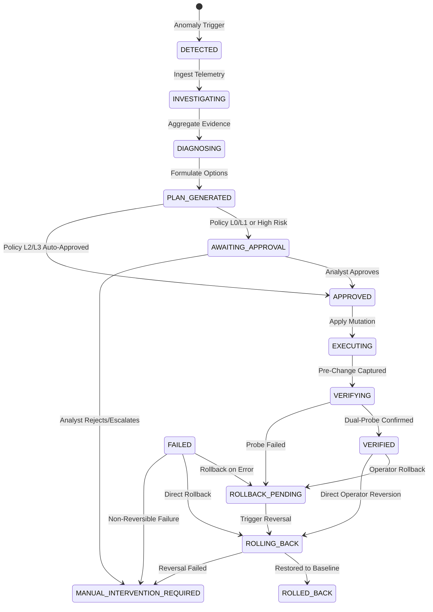

# REMEDIATION LIFECYCLE ENGINE: 14-STAGE STATE MACHINE
**Platform:** AutoHeal AI-Assisted Autonomous Security Operations Center  
**Target Environment:** ShopSphere E-Commerce Application  
**Phase:** Phase 7 — Advanced Self-Healing Command Center  
**Status:** APPROVED & TESTED (100% Passing State Transitions)

---

## 1. Overview & Architectural Rationale

Traditional remediation systems suffer from brittle binary states (`OPEN` / `CLOSED`) or uncontrolled side effects without verifiable intermediate states. AutoHeal v3.0 implements a deterministic, audited **14-Stage Remediation Lifecycle State Machine** backed by SQLite WAL persistence in `self_healing_executions` and audited in `self_healing_audit_logs`.

State transitions are strictly validated on the backend. Attempting an invalid transition (such as skipping diagnosis or executing without approval) is rejected with an HTTP 400 error.

---

## 2. The 14 Lifecycle Stages

### Detailed Stage Specifications

1. **`DETECTED`**:
   - Initial state when detection rule or correlator flags an incident.
   - Initialized with incident ID, severity, affected asset, and default risk rating.
2. **`INVESTIGATING`**:
   - Automated ingestion of event streams (`security_events`), client IP history, and target endpoints.
3. **`DIAGNOSING`**:
   - Telemetry correlated to formulate Root-Cause Analysis. Confirmed facts isolated from hypotheses.
4. **`PLAN_GENERATED`**:
   - Remediation planner evaluates viable actions, reversibility, and risk score vectors (4–14).
5. **`AWAITING_APPROVAL`**:
   - Human gate mandatory when autonomy policy is Level 0/1 or when action risk exceeds configured threshold.
6. **`APPROVED`**:
   - Authorized either autonomously via policy Level 2/3 allowlist or explicitly by human operator.
7. **`EXECUTING`**:
   - Pre-change state captured (existing blocks, user tokens, AST diffs).
   - Real action applied (WAF block, rate throttle, session invalidate, AST code repair).
8. **`VERIFYING`**:
   - Independent synthetic probes executed against application enforcement layer.
9. **`VERIFIED`**:
   - Containment confirmed: adversary blocked (403/429) AND benign shopping flow unimpaired (200).
   - Incident marked `CONTAINED` in `security_incidents`.
10. **`FAILED`**:
    - Execution error or unexpected runtime anomaly.
11. **`ROLLBACK_PENDING`**:
    - Automatic or operator-requested transition when verification fails or operator requests reversal.
12. **`ROLLING_BACK`**:
    - Active restoration of pre-change state snapshot.
13. **`ROLLED_BACK`**:
    - Baseline verified clean. Original state restored.
14. **`MANUAL_INTERVENTION_REQUIRED`**:
    - Rollback failure or unrecoverable invariant violation requiring senior SRE / SOC intervention.

---

## 3. Allowed Transition Matrix

| Current Stage | Allowed Next Stages |
| :--- | :--- |
| `DETECTED` | `INVESTIGATING`, `FAILED` |
| `INVESTIGATING` | `DIAGNOSING`, `FAILED` |
| `DIAGNOSING` | `PLAN_GENERATED`, `FAILED` |
| `PLAN_GENERATED` | `AWAITING_APPROVAL`, `APPROVED`, `FAILED` |
| `AWAITING_APPROVAL` | `APPROVED`, `FAILED`, `MANUAL_INTERVENTION_REQUIRED` |
| `APPROVED` | `EXECUTING`, `FAILED` |
| `EXECUTING` | `VERIFYING`, `FAILED`, `ROLLBACK_PENDING` |
| `VERIFYING` | `VERIFIED`, `FAILED`, `ROLLBACK_PENDING` |
| `VERIFIED` | `INVESTIGATING`, `FAILED`, `ROLLBACK_PENDING`, `ROLLING_BACK` |
| `FAILED` | `ROLLBACK_PENDING`, `ROLLING_BACK`, `MANUAL_INTERVENTION_REQUIRED`, `INVESTIGATING` |
| `ROLLBACK_PENDING` | `ROLLING_BACK`, `MANUAL_INTERVENTION_REQUIRED` |
| `ROLLING_BACK` | `ROLLED_BACK`, `MANUAL_INTERVENTION_REQUIRED` |
| `ROLLED_BACK` | `INVESTIGATING`, `MANUAL_INTERVENTION_REQUIRED`, `DETECTED` |
| `MANUAL_INTERVENTION_REQUIRED` | `INVESTIGATING`, `AWAITING_APPROVAL`, `ROLLED_BACK`, `APPROVED` |

---

## 4. Audit Persistence

Every state transition invokes `log_self_healing_audit`:
- **`log_id`**: Cryptographic unique identifier (`SH-LOG-...`).
- **`action_type`**: `STAGE_TRANSITION`.
- **`execution_id`**: Affected remediation ID.
- **`incident_id`**: Related security incident ID.
- **`actor`**: Operating analyst or autonomy policy level.
- **`details_json`**: `from_stage`, `to_stage`, `reason`, `metadata`.
- **`timestamp`**: UTC current timestamp.
