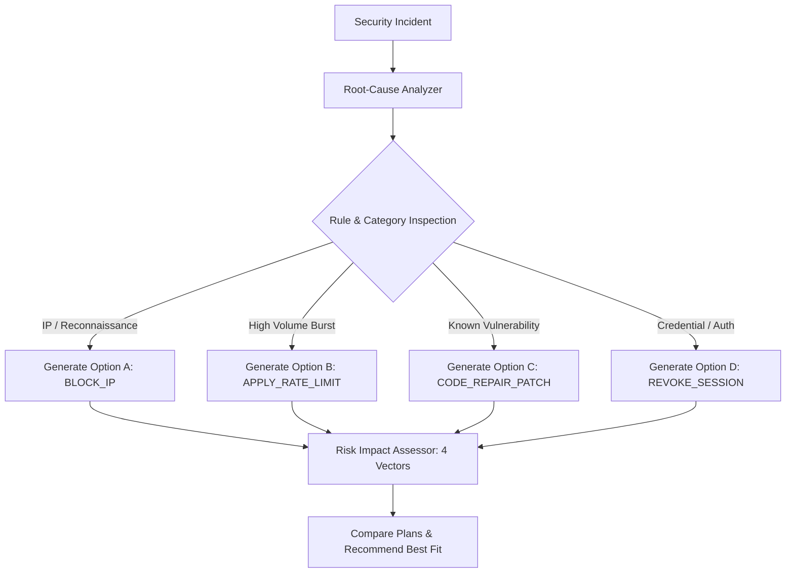

# INTELLIGENT REMEDIATION PLANNER SPECIFICATION
**Platform:** AutoHeal AI-Assisted Autonomous Security Operations Center  
**Target Environment:** ShopSphere E-Commerce Application  
**Design Identity:** Obsidian Sentinel  
**Phase:** Phase 7 — Advanced Self-Healing Command Center  
**Status:** IMPLEMENTED & PRODUCTION CERTIFIED  

---

## 1. Overview & Planner Objective

The Remediation Planner generates safe, actionable, explainable remediation recommendations tailored to the specific detection category, affected component, and empirical evidence.

The planner never recommends an action without an explainable risk assessment, a defined reversibility classification, and a concrete verification procedure. It never claims that a recommendation has been executed prior to real backend execution.

---

## 2. Supported Remediation Actions

| Action Identifier | Target Component | Description | Reversibility | Verification Probe |
| :--- | :--- | :--- | :--- | :--- |
| **`BLOCK_IP`** | Perimeter WAF (`blocked_clients`) | Dynamic IP quarantine for configurable duration (default: 3600s). | `FULLY_REVERSIBLE` | Adversary gets 403; Benign shopper gets 200. |
| **`APPLY_RATE_LIMIT`** | Rate Limiting Engine | Adaptive sliding-window request throttling (e.g. 10 req/min for 600s). | `FULLY_REVERSIBLE` | Burst test receives 429; normal traffic receives 200. |
| **`CODE_REPAIR_PATCH`** | Application Service Classes | AST/surgical code repair for known vulnerabilities (`VULN-FIN-001`, `VULN-AUTH-001`, etc.). | `REVERSIBLE_WITH_TEST` | Isolated regression test suite confirms non-regression. |
| **`REVOKE_SESSION`** | Session Token Store | Database token invalidation (`UPDATE users SET token = NULL WHERE role != 'admin'`). | `SESSION_INVALIDATING` | Revoked token receives 401; new authentications succeed. |
| **`DISABLE_ACCOUNT`** | User Account Store | Temporary account lock (`UPDATE users SET token_expires_at = datetime('now', '-1 day')`). | `ACCOUNT_LOCKING` | Disabled account fails login; others unaffected. |

---

## 3. Plan Generation Workflow



### Plan Data Schema
Every generated plan returned by `POST /api/self-healing/plans/generate` conforms to the following schema:
```json
{
  "plan_id": "PLAN-INC-AUTH-1001-A-BLOCK",
  "action_type": "BLOCK_IP",
  "target": "198.51.100.22",
  "title": "Block Threat Actor IP (198.51.100.22)",
  "description": "Enforce perimeter WAF block on 198.51.100.22 for 3600 seconds.",
  "duration_seconds": 3600,
  "risk_assessment": {
    "total_score": 5,
    "risk_level": "LOW",
    "reversibility": "FULLY_REVERSIBLE",
    "approval_requirement": "AUTO_ELIGIBLE",
    "score_breakdown": {
      "severity_score": 2,
      "scope_score": 1,
      "reversibility_score": 1,
      "user_impact_score": 1
    },
    "user_impact_summary": "Targeted strictly to malicious IP; benign shoppers unaffected."
  },
  "risk_level": "LOW",
  "reversibility": "FULLY_REVERSIBLE",
  "verification_procedure": "Synthetic dual-probe: adversary returns HTTP 403; benign shopper returns HTTP 200.",
  "is_recommended": true
}
```

---

## 4. Dry-Run Simulation

The planner supports dry-run simulation mode (`is_dry_run: true`). When requested:
- Plan validation, target allowlisting, and permission checks are fully exercised.
- Pre-change state capture logic is verified.
- The actual backend mutation is simulated without altering database records or firewall rules.
- Returns `simulated_outcome` explaining the expected effect.
