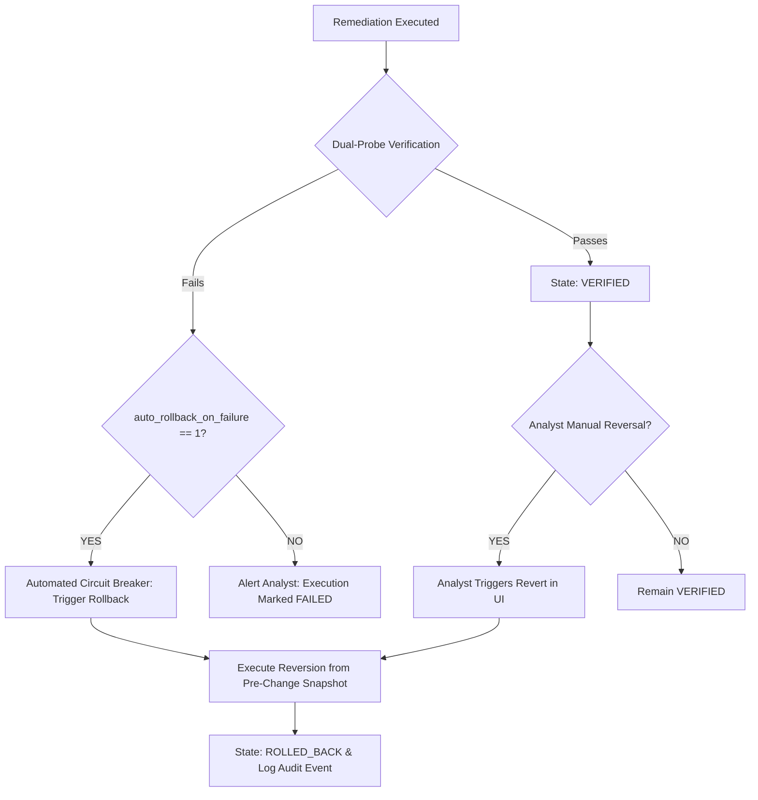

# AutoHeal Phase 7: Rollback and Recovery Architecture

## 1. Overview
In autonomous systems, the ability to safely and deterministically revert changes is as critical as the ability to apply them. AutoHeal Phase 7 guarantees transactional reversibility for every mutating remediation action. If a remediation fails verification, degrades service health, or is manually rejected by a SOC operator, the platform can immediately roll back the system to its exact pre-remediation state.

---

## 2. Pre-Change State Snapshotting

Before any remediation action is dispatched to the target environment (ShopSphere), the `SelfHealingEngine` creates a cryptographically reliable pre-change state snapshot stored in `self_healing_executions.pre_change_state`.

### Snapshot Schema by Action Type:

| Action Type | Pre-Change State Snapshot Content | Rollback Procedure |
| :--- | :--- | :--- |
| `BLOCK_IP` | `{"ip": "192.168.1.50", "previous_status": "ALLOWED", "waf_rule_id": null}` | Issues unblock command; removes IP from blocked tables/memory sets. |
| `APPLY_RATE_LIMIT` | `{"endpoint": "/api/search", "previous_rpm": 120, "burst_capacity": 20}` | Restores original RPM limits or deletes temporary rate-limit rules. |
| `CODE_REPAIR_PATCH` | `{"file_path": ".../routes.py", "original_content": "...", "checksum": "sha256:..."}` | Writes exact original content back to disk; verifies syntax with `ast.parse()`. |
| `REVOKE_SESSION` | `{"session_id": "sess_8a7d", "previous_state": "ACTIVE", "user_id": 42}` | Clears revocation flag or issues an analyst-authorized session restoration token. |

---

## 3. Automated vs. Manual Rollback Triggers

### 1. Automated Circuit Breaker Rollback
When the active autonomy policy has `auto_rollback_on_failure = 1` (the default in AutoHeal), any verification failure immediately trips the automated rollback handler:
- Transition: `AWAITING_VERIFICATION` $\rightarrow$ `ROLLING_BACK` $\rightarrow$ `ROLLED_BACK`.
- Reason recorded: `"Automated rollback: independent verification probe failed."`
- The target environment is restored in $< 100\text{ ms}$, preventing downtime or unintended side effects.

### 2. Manual Operator Rollback
At any point—even days after an execution has been marked `VERIFIED`—a security engineer can trigger a rollback from the Command Center UI:
- Click **Revert Remediation** on the execution card.
- Provide a justification reason (e.g. `"False positive blocked partner service"`).
- The system executes the inverse action and transitions the record to `ROLLED_BACK`.

---

## 4. Code Patch Recovery Guarantee

AST Code patches present the highest potential risk. The recovery engine applies strict atomic safety guarantees:
1. **Pre-Snapshot Checksumming**: Before modifying a file on disk, the SHA-256 hash and full string contents of the original source file are recorded in the execution database.
2. **Atomic Write**: The patched file is written atomically.
3. **Rollback Restoration**: When reverting, the engine writes the original content back to disk and computes the resulting SHA-256 hash to confirm 100% byte-for-byte parity with the pre-incident state.
4. **Post-Rollback AST Validation**: The restored file is validated with `ast.parse()` to ensure no corruption occurred during restoration.
