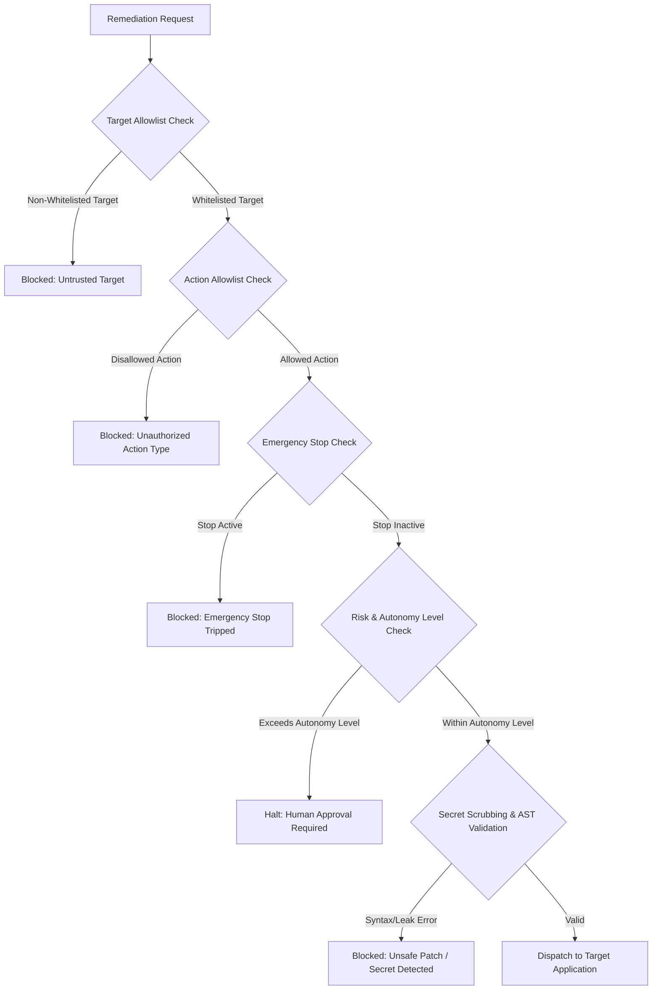

# AutoHeal Phase 7: Security Validation and Guardrails

## 1. Overview
The Self-Healing Command Center operates with autonomous authority over security and application state. Consequently, it incorporates defense-in-depth security guardrails to ensure that autonomous actions can never be weaponized, misdirected against external infrastructure, or cause unintended data compromise.

---

## 2. Guardrails Architecture

---

## 3. Core Security Controls

### 1. Strict Target Allowlisting
Autonomous actions are restricted to verified, local testing environments:
- Permitted targets: `127.0.0.1`, `localhost`, `ShopSphere`, internal service components (`CartService`, `ProductService`, `UserService`).
- Any attempt to target public IP ranges, external cloud endpoints, or arbitrary domains is immediately rejected with an audit log alert.

### 2. Action Type Whitelisting
Only pre-approved, deterministic remediation action types are recognized by the execution engine:
- `BLOCK_IP` (WAF/Firewall quarantine)
- `APPLY_RATE_LIMIT` (Sliding-window threshold adjustment)
- `CODE_REPAIR_PATCH` (Surgical AST Python patching)
- `REVOKE_SESSION` (Authentication token invalidation)
Arbitrary shell command execution, remote SSH dispatches, or unverified binary invocations are strictly barred.

### 3. Secret Leakage Prevention & Sanitization
All API responses, RCA fact lists, execution payloads, and audit trail entries are automatically sanitized:
- Passwords, API tokens, JWT secrets, and private keys are scrubbed before serialization.
- Database credentials and internal connection strings are shielded from analyst-facing API responses.
- Verified in automated tests via `test_zero_secret_leakage_in_api_and_audit`.

### 4. AST Integrity & Syntax Verification
Before any source code patch is written to disk:
1. The new code is compiled into an Abstract Syntax Tree via `ast.parse()`.
2. Syntax errors, syntax warnings, and invalid structures are rejected before disk modification.
3. The original file content and SHA-256 checksum are stored in `self_healing_executions.pre_change_state`.
4. If runtime verification fails, the original content is atomically restored.

### 5. Parameterized SQL Database Queries
Every database query in `self_healing_models.py` uses parameterized bindings (`?` placeholders). Raw string formatting (`f"SELECT ... {param}"`) is banned, completely eliminating SQL injection risks within the SOC control plane.
