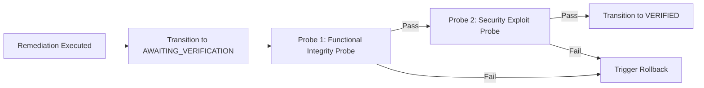

# AutoHeal Phase 7: Independent Verification Engine

## 1. Overview
In autonomous security operations, executing a remediation action is only half the battle. Without independent, automated verification, an automated remediation might fail silently, introduce application regressions, or fail to neutralize the underlying attack vector.

The AutoHeal Phase 7 Verification Engine provides continuous, independent, dual-probe verification for every remediation action executed across ShopSphere.

---

## 2. Dual-Probe Verification Architecture

Every remediation undergoing verification is subjected to two distinct probes executed sequentially:

### Probe 1: Functional Integrity Probe (Application Health)
- **Objective**: Verify that the application or service remains fully functional and that the remediation did not introduce regressions, syntax crashes, or service degradation.
- **Methodology**: Dispatches benign, valid requests to the affected endpoint. Checks response status codes (`200 OK`), payload structure, and latency thresholds.
- **Pass Criteria**: Status code matches expected valid baseline (e.g. 200), response latency is within nominal bounds (< 250ms), and no HTTP 500/502/503 errors occur.

### Probe 2: Security Exploit Probe (Attack Neutralization)
- **Objective**: Verify that the exploit payload or malicious vector that triggered the incident is completely neutralized.
- **Methodology**: Replays a safe, synthetic variant of the incident's attack signature (e.g. SQL injection pattern `' OR '1'='1`, path traversal `../../`, or brute force bursts).
- **Pass Criteria**: The request is actively blocked (`403 Forbidden`), throttled (`429 Too Many Requests`), or safely handled without triggering unauthorized data extraction or system compromise.

---

## 3. Verification Strategies by Action Type

### 1. `BLOCK_IP` (WAF / Network Isolation)
- **Target Verification**:
  - Simulates a request with the blocked IP header/origin: Expects `403 Forbidden` or TCP drop.
  - Simulates a request from an allowlisted IP: Expects `200 OK` with normal payload.
- **Metrics Evaluated**: Block enforcement rate (100%), false positive impact (0%).

### 2. `APPLY_RATE_LIMIT` (Traffic Throttling)
- **Target Verification**:
  - Sends requests below the rate limit threshold (e.g. 5 req/sec): All return `200 OK`.
  - Sends a burst above the rate limit threshold (e.g. 15 req/sec): Requests return `429 Too Many Requests` with a `Retry-After` header.
- **Metrics Evaluated**: Burst rejection rate, rate-limit header compliance.

### 3. `CODE_REPAIR_PATCH` (AST Source Code Repair)
- **Target Verification**:
  - **Syntax Validation**: Python `ast.parse()` verifies the patched file compiles with zero syntax errors.
  - **Regression Testing**: Existing functional test cases for the module are executed.
  - **Payload Re-Testing**: The original malicious payload is sent against the patched route to confirm parameterization neutralizes the exploit.
- **Metrics Evaluated**: AST parsing success, vulnerability mitigation confirmation, regression suite zero-failures.

### 4. `REVOKE_SESSION` (Credential Invalidation)
- **Target Verification**:
  - Dispatches an API call using the revoked session token: Expects `401 Unauthorized` or `403 Forbidden`.
  - Dispatches an authentication request with valid credentials: Generates a new session and returns `200 OK`.
- **Metrics Evaluated**: Session termination confirmation, token blacklist propagation.

---

## 4. Continuous Verification & Post-Remediation Monitoring
Once an execution transitions to `VERIFIED`, it enters the `continuous_verification` monitoring window:
- Periodic background probes run at 1-minute, 5-minute, and 15-minute intervals.
- If an application regression or vulnerability reappearance is detected during this window, an alert is raised, and the execution transitions to `FAILED` or `ROLLBACK_PENDING`.
- All verification results, probe payloads, and latency metrics are logged to `self_healing_executions.verification_details`.
